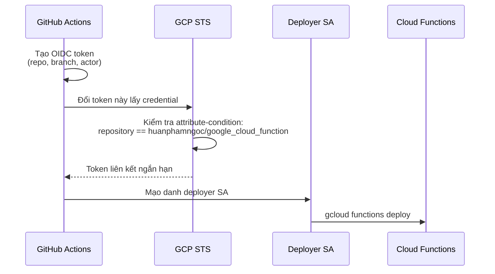
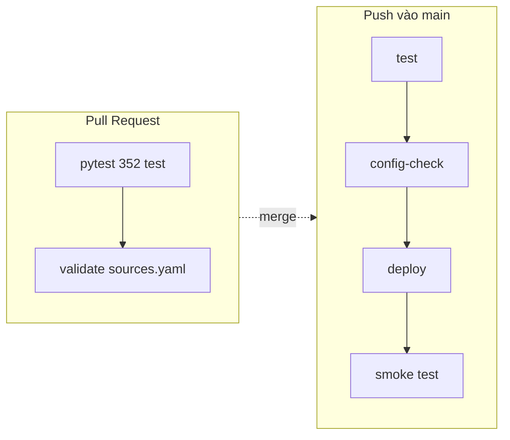

# Chuyển CI/CD từ Cloud Build sang GitHub Actions

Repo: `https://github.com/huanphamngoc/google_cloud_function`

Thay thế [CICD.md](CICD.md) (Cloud Build). Giữ nguyên nội dung pipeline — test,
kiểm tra config, deploy, smoke test — chỉ đổi nơi chạy và cách xác thực.

---

## Khác biệt cốt lõi: xác thực

Đây là điểm duy nhất thực sự khó, và cũng là lý do nhiều hướng dẫn trên mạng sai.

**Cloud Build chạy *bên trong* GCP.** Nó gắn sẵn service account, không có bí mật
nào tồn tại.

**GitHub Actions chạy trên máy của GitHub, *ngoài* GCP.** Nó phải tự chứng minh
danh tính:

| Cách | Đánh giá |
|---|---|
| Tải key JSON của SA, lưu vào GitHub Secrets | ❌ Key tồn tại vĩnh viễn, không tự xoay vòng, rò rỉ là mất quyền. Đúng thứ `.gitignore` đang chặn |
| **Workload Identity Federation** | ✅ GitHub phát hành OIDC token → GCP đổi lấy credential ngắn hạn. **Không có key nào** |

Hướng dẫn này dùng WIF. **Không có gì được đưa vào GitHub Secrets.**



**`attribute-condition` là ranh giới bảo mật, không phải thủ tục.** Thiếu nó thì
*bất kỳ repo GitHub nào trên thế giới* cũng có thể đưa token vào provider này và
mạo danh deployer. Google nay từ chối tạo provider GitHub nếu không có điều kiện.

---

## Những file đã tạo sẵn

| File | Vai trò |
|---|---|
| [`.github/wif-setup.sh`](.github/wif-setup.sh) | Dựng WIF + deployer SA + quyền. Chạy một lần |
| [`.github/workflows/tests.yml`](.github/workflows/tests.yml) | Chạy test trên **mọi Pull Request**. Không deploy, không cần quyền GCP |
| [`.github/workflows/deploy-sheets-multi-scd2.yml`](.github/workflows/deploy-sheets-multi-scd2.yml) | test → config-check → deploy → smoke test |
| [`.github/workflows/deploy-sheet-to-bq-loader.yml`](.github/workflows/deploy-sheet-to-bq-loader.yml) | Function cũ |

---

## Bước 1 — Dựng Workload Identity Federation

```bash
bash .github/wif-setup.sh
```

Script tạo:

1. **Deployer SA riêng** `github-actions-deployer@` — tách khỏi SA runtime có chủ
   đích: nó được phép deploy nhưng **không** được đọc Sheet hay ghi BigQuery.
2. **Pool + provider** kèm `attribute-condition` ghim đúng repo của bạn.
3. **Ba quyền** đã từng gây lỗi 403 trong lúc dựng Cloud Build — lần này viết sẵn
   thay vì mò ra từ build đỏ:
   - `cloudfunctions.developer`
   - `iam.serviceAccountUser` trên SA **runtime**
   - `iam.serviceAccountUser` trên SA **compute** (SA build container của gen2)

Deploy function gen2 cần `actAs` trên **hai** service account, không phải một. Đây
chính là lỗi cuối cùng bạn gặp với Cloud Build.

Cuối script in ra hai giá trị. Chúng **đã được điền sẵn** vào các file workflow —
chỉ cần đối chiếu cho khớp:

```
WIF_PROVIDER: projects/722092646648/locations/global/workloadIdentityPools/github-pool/providers/github-provider
DEPLOYER_SA:  github-actions-deployer@elt-drive-to-bq.iam.gserviceaccount.com
```

Hai giá trị này **không phải bí mật**. Provider path vô dụng nếu
`attribute-condition` không khớp repo; email SA không phải credential. Đó là lý do
chúng nằm thẳng trong file workflow chứ không trong Secrets.

---

## Bước 2 — Push

```bash
git add .github .gitignore
git commit -m "Move CI/CD to GitHub Actions with Workload Identity Federation"
git push
```

Workflow `tests.yml` chạy ngay. Hai workflow deploy chỉ chạy khi thư mục function
tương ứng thay đổi (`paths:` filter) — tương đương `--included-files` của Cloud
Build.

---

## Bước 3 — Chạy thử deploy

Không cần sửa file để kích hoạt. Vào **GitHub → Actions → Deploy sheets-multi-scd2
→ Run workflow** (nhờ `workflow_dispatch`).

Hoặc:

```bash
gh workflow run deploy-sheets-multi-scd2.yml
```

---

## Bước 4 — Tắt Cloud Build

Chỉ làm sau khi GitHub Actions deploy xanh ít nhất một lần. Chạy song song hai hệ
thống cùng deploy một function sẽ gây tranh chấp revision.

```bash
gcloud builds triggers list --format="value(name)"

gcloud builds triggers delete deploy-sheets-multi-scd2 --region=global
gcloud builds triggers delete deploy-sheet-to-bq-loader --region=global
```

Giữ lại file `cloudbuild.yaml` thêm vài tuần phòng khi cần quay lại, rồi xoá.

---

## Pipeline chạy gì



| Job | Nội dung | Cần quyền GCP? |
|---|---|---|
| `test` | 352 test + parse `sources.yaml` | Không |
| `deploy` | `gcloud functions deploy` | Có (WIF) |
| `smoke-test` | Gọi function với `?dry_run=1` | Có (OIDC token) |

### Vì sao smoke test phải xác thực hai lần

Job `deploy` xin **access token** để gọi API GCP. Job `smoke-test` cần **ID
token** với `audience` đúng bằng URL của function — mà URL chỉ tồn tại sau khi
deploy xong. Nên nó gọi `google-github-actions/auth` lần nữa với
`token_format: id_token`.

Đây là chỗ các hướng dẫn hay dùng `gcloud auth print-identity-token`. Cách đó
**không chạy** với WIF: credential liên kết không tự tạo được ID token.

---

## Lợi ích so với Cloud Build

| | Cloud Build | GitHub Actions |
|---|---|---|
| Kiểm tra Pull Request | Phải dựng trigger thứ hai | ✅ `tests.yml`, có sẵn |
| Log | Cloud Logging, tách khỏi code | ✅ Ngay cạnh commit |
| Cổng duyệt thủ công | Không có | ✅ `environment` + reviewers |
| Chặn deploy đồng thời | Không có | ✅ `concurrency` |
| Chạy tay không cần push | Không | ✅ `workflow_dispatch` |
| Tóm tắt kết quả | Không | ✅ `$GITHUB_STEP_SUMMARY` |

Hai dòng đầu là lý do thực sự để đổi. Phần còn lại là tiện thêm.

---

## Lỗi thường gặp

| Lỗi | Nguyên nhân | Xử lý |
|---|---|---|
| `Permission denied on resource` lúc auth | `attribute-condition` không khớp repo | Kiểm tra chính tả owner/repo trong `wif-setup.sh` |
| `unable to get credentials` | Thiếu `permissions: id-token: write` | Đã có sẵn trong file — đừng xoá |
| `iam.serviceAccounts.actAs denied` | Thiếu actAs trên SA compute | Chạy lại `wif-setup.sh` |
| Smoke test 403 | Deployer chưa có `run.invoker` | Chạy lại `wif-setup.sh` **sau** lần deploy đầu |
| Workflow không chạy khi push | `paths:` không khớp | Dùng `workflow_dispatch` để chạy tay |

Lưu ý mục 4: lần đầu tiên chạy, function còn chưa tồn tại nên script không cấp
được `run.invoker`. Deploy xong, chạy lại `wif-setup.sh` một lần nữa.

---

## Nên làm thêm

**Bảo vệ nhánh `main`**: Settings → Branches → yêu cầu `tests.yml` phải xanh mới
merge được. Không có bước này thì kiểm tra PR chỉ là thông tin tham khảo.

**Cổng duyệt deploy**: Settings → Environments → tạo `production` với required
reviewers, rồi thêm `environment: production` vào job `deploy`. Thứ Cloud Build
không làm được.

**Thông báo khi fail**: GitHub gửi email mặc định cho người push. Muốn vào Slack
thì thêm một step `if: failure()`.

---

## Phụ lục — chạy `wif-setup.sh` trên Windows

Script là bash, nên trên Windows phải chạy qua Git Bash. Có một cái bẫy:

**PowerShell** gọi `gcloud.cmd`, file này tự chọn Python đi kèm Cloud SDK.
**Git Bash** gọi script `gcloud` kiểu Unix, file này lấy `python` đầu tiên trên
PATH. Nếu đó là Python 3.9 thì gcloud không chạy được — phiên bản này đã bị bỏ
hỗ trợ — và triệu chứng là `You do not currently have an active account selected`
dù PowerShell vừa `gcloud auth login` thành công.

Sửa bằng cách trỏ gcloud về Python bundled của chính Cloud SDK:

```powershell
$env:CLOUDSDK_PYTHON = "C:\Users\Admin\AppData\Local\Google\Cloud SDK\google-cloud-sdk\platform\bundledpython\python.exe"
bash .github/wif-setup.sh
```

Kiểm tra trước khi chạy script:

```powershell
bash -c "gcloud auth list"
```

Phải thấy tài khoản của bạn có dấu `*`. Nếu vẫn lỗi, chạy script trong **Cloud
Shell** thay vì máy local — Linux thật, gcloud đã đăng nhập sẵn, không có lớp
Windows nào ở giữa.
