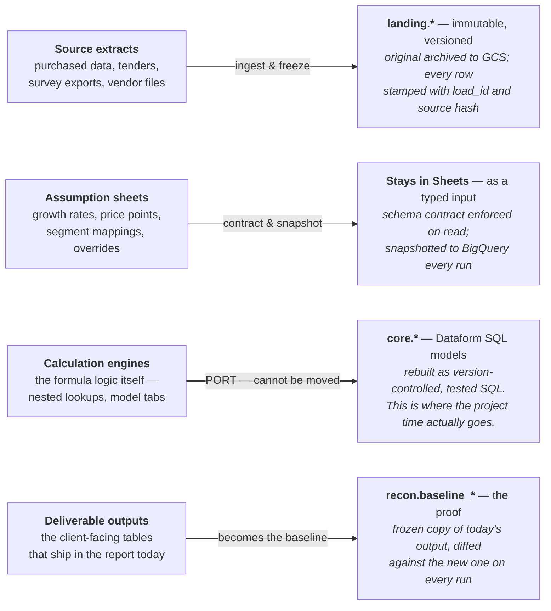
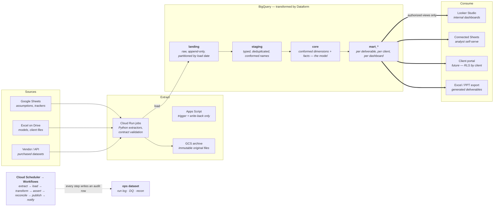
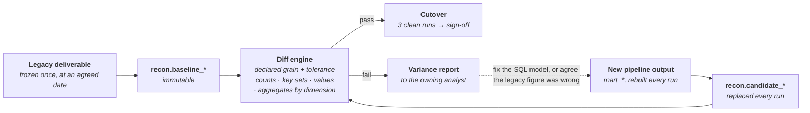

# From spreadsheets to a governed BigQuery core

**Target architecture and migration pattern — Clearstate cloud migration / data engineering**

| | |
|---|---|
| **Scope** | One pilot dataset → programme pattern |
| **Core stack** | BigQuery · Dataform · Cloud Run · Workflows |
| **Pilot window** | 10 weeks |
| **Status** | Draft for review |
| **Source brief** | [requirement/jd.md](../requirement/jd.md) |
| **Schema evolution** | [schema-evolution.md](schema-evolution.md) - design doc + working implementation |
| **Diagrams** | [diagrams/](diagrams/) - Mermaid sources |
| **Reference code** | [src/clearstate_ingest/](../src/clearstate_ingest/), [tests/](../tests/) - 180 tests |
| **Published version** | https://claude.ai/code/artifact/ef4f9e06-ea4a-4934-a8d6-06202573d897 |

Move the system of record into BigQuery, keep analysts working where their judgement lives, and prove every migrated number against the deliverable it replaces before anyone is asked to trust it.

---

## Contents

1. [The real problem is not storage](#01--the-real-problem-is-not-storage)
2. [Four kinds of spreadsheet](#02--four-kinds-of-spreadsheet)
3. [Target architecture](#03--target-architecture)
4. [The BigQuery layer model](#04--the-bigquery-layer-model)
5. [Ingestion patterns](#05--ingestion-patterns)
6. [Orchestration and refresh](#06--orchestration-and-refresh)
7. [Quality and reconciliation](#07--quality-and-reconciliation)
8. [Serving, visualisation and the future portal](#08--serving-visualisation-and-the-future-portal)
9. [Security, cost and performance standards](#09--security-cost-and-performance-standards)
10. [CI/CD, environments and documentation](#10--cicd-environments-and-documentation)
11. [The migration factory](#11--the-migration-factory)
12. [Pilot plan, and what I need from you](#12--pilot-plan-and-what-i-need-from-you)

---

## 01 — The real problem is not storage

> Copying sheets into BigQuery is a week of work. Making the warehouse the thing people actually trust and use is the whole programme — and it fails for reasons that have nothing to do with the loader.

The stated objective is BigQuery as the central data layer and fewer manual, spreadsheet-based processes. Both are achievable, but the failure mode of this kind of migration is well understood: the pipelines get built, the tables land, and the analysts keep using the spreadsheet anyway — because the spreadsheet is where the assumptions live, because nobody proved the new numbers matched the old ones, and because the first time a column got renamed the pipeline broke silently.

So this design is organised around three commitments rather than a component list:

- **The warehouse becomes the system of record; the spreadsheet stays as an interface.** Analysts keep entering assumptions in Sheets. What changes is that those sheets become governed, contracted, versioned inputs to a pipeline — not the calculation engine itself.
- **Nothing is "migrated" until it reconciles.** Reconciliation against the existing deliverable is a release gate with a numeric tolerance, not a report someone reads once. §07 makes this a first-class piece of the platform.
- **The second dataset must be configuration, not a project.** Every part of the pilot is built as a template with the dataset-specific parts pushed into a declarative config file. §11 is the payoff.

> ⚠️ **Assumption to confirm.** This design assumes source data is market-intelligence material — country- and segment-level sizing, pricing, penetration and share estimates built from a mix of purchased data, primary research and analyst judgement — with deliverables shipped as Excel and slides. The worked examples below use a country × year × product-segment market sizing model. If the priority dataset is shaped differently (transactional, survey-level, or document-heavy), the layer model holds but §04 and §11 need reshaping.

---

## 02 — Four kinds of spreadsheet

> The single most useful thing to do in week one is stop treating "the spreadsheets" as one category. Each of the four kinds has a different destination, and one of them cannot be moved at all.



**The classification drives the plan.** Three of the four categories are engineering work with known patterns. The third — porting formula logic into SQL — is analytical archaeology, is the only one that needs an analyst in the room, and is where estimates go wrong. Size the project on that row.

### What this means in practice

| Kind | Treatment | Who owns it after | Effort |
|---|---|---|---|
| Source extracts | Automated ingest to `landing`, original archived to GCS, append-only with load lineage | Data engineering | Low — templated |
| Assumption sheets | Stay in Sheets. Gain a schema contract, a validation tab, and a snapshot on every run | Analysts, with a contract | Low–medium |
| Calculation engines | Reverse-engineered and rewritten as Dataform SQL models with assertions | Data engineering + analyst | **High — the critical path** |
| Deliverable outputs | Frozen as reconciliation baseline, then regenerated from `mart` tables | Pipeline, analyst signs off | Medium |

> ⚠️ **The trap to avoid.** Do not lift assumption sheets into BigQuery as static tables. The moment an analyst has to raise a ticket to change a growth rate, they will fork the sheet and the warehouse becomes stale within a quarter. Assumptions belong in Sheets, read fresh on every run, with a contract that fails loudly when the shape changes.

---

## 03 — Target architecture

> Serverless throughout, no always-on infrastructure, and a strict rule that nothing downstream ever reads the landing zone directly.



**The two rules the diagram encodes.** Everything enters through a single orchestrated run that writes an audit row at each step, and every consumer reads an authorized view over `mart` — never a base table. That second rule is what makes it safe to refactor `core` later without breaking a dashboard someone built in 2027.

> No always-on compute. No Composer at pilot scale. No consumer reads `landing` or `staging`.

### Component choices, and what I would trade

**Chosen · Dataform over dbt Core.** Serverless and native to BigQuery, git-backed, assertions built in, uses GCP IAM, no host to run. dbt has the richer ecosystem, but it needs Cloud Composer or a Cloud Run runner and a second set of credentials. For a small team this is the lower-drag choice, and SQL models port to dbt later if the team outgrows it.

**Chosen · Scheduler + Workflows over Composer.** Composer is roughly a three-figure monthly bill before it runs a single task, plus an Airflow environment to maintain. Workflows costs cents, handles retries and conditional branching, and calls Cloud Run and the Dataform API directly. Revisit only when cross-dataset dependencies genuinely need a scheduler with a DAG-aware backfill story.

**Chosen · Cloud Run jobs over Cloud Functions.** Extractors handle whole workbooks, need pandas and openpyxl, and occasionally run long. Cloud Run jobs give a proper container, up to 24 hours, and the same image runs locally for debugging. Functions are fine for tiny event handlers; they are a poor home for a spreadsheet parser.

**Constrained · Apps Script as trigger and writer, never as ETL.** It is the only thing that can put a button in a sheet and write results back into a formatted tab, so it earns a place. But it has no meaningful version control, no test framework and a six-minute execution ceiling. Business logic in Apps Script becomes the next thing you have to migrate.

---

## 04 — The BigQuery layer model

> Datasets as zones, one naming convention, and table design decided by how the data is queried rather than how it arrived.

### Datasets and naming

| Dataset | Contains | Write access | Retention |
|---|---|---|---|
| `landing` | `raw_<source>__<entity>` — untyped-ish, append-only, one partition per load | Extractor SA only | 13 months |
| `staging` | `stg_<source>__<entity>` — typed, deduplicated to current version, renamed to house convention | Dataform SA | Rebuilt |
| `core` | `dim_<entity>`, `fct_<process>` — conformed, source-agnostic, the business model | Dataform SA | Permanent |
| `mart_<area>` | `rpt_<deliverable>` — shaped for one dashboard, deliverable or client | Dataform SA | Permanent |
| `recon` | `baseline_*`, `candidate_*`, `variance_*` — the migration proof | Dataform SA | Until sign-off + 12m |
| `ops` | `run_log`, `dq_results`, `recon_results`, `schema_drift`, `cost_by_label` | All pipeline SAs | 24 months |
| `sandbox_<user>` | Analyst scratch space, 30-day table expiry set at dataset level | The named user | 30 days |

### Worked example — the core model

For a country × year × segment market sizing dataset, the core layer resolves to a small star that most deliverables can be built from:

```sql
-- core (conformed, source-agnostic)
dim_country            country_code, country_name, region, income_band, is_active
dim_product_segment    segment_id, segment_name, parent_segment_id, therapy_area
dim_vendor             vendor_id, vendor_name, parent_group, is_active
dim_date               date_key, year, quarter, fiscal_year

fct_market_size        country_code, segment_id, year, scenario_code,
                       volume_units, asp_usd, value_usd,
                       estimate_method, confidence_code,
                       assumption_set_id, load_id, _valid_from, _valid_to

fct_vendor_share       country_code, segment_id, vendor_id, year,
                       share_pct, value_usd, assumption_set_id, load_id
```

Two columns there do most of the governance work. `assumption_set_id` points at the exact snapshot of the analyst assumption sheet that produced the row, so any number can be traced back to the growth rate and price point behind it. `load_id` points at the `ops.run_log` entry, so any number can be traced back to the run that wrote it. Together they make "why did this figure change since last month?" a query rather than an investigation.

### Physical design

- **Partition** facts on the business date (`year` as an integer-range partition, or `report_date` as a date partition). Partition `landing` tables on ingestion date instead — different question, different key.
- **Cluster** on the columns that appear in filters and joins, most selective first: typically `country_code, segment_id`. Clustering is free to define and cuts scan cost sharply on the filters analysts actually use.
- **Require a partition filter** on large facts so an accidental full scan fails instead of billing.
- **Slowly changing dimensions**: type 2 on `dim_product_segment` and `dim_vendor`, because segment reclassification and vendor acquisitions are exactly the things that silently break a year-on-year comparison. Type 1 elsewhere.
- **Restatement over mutation**: never update a published fact in place. Write a new version with a new `load_id` and let the view select the current one. Deliverables that shipped must stay reproducible.

### Incremental loads

The default pattern is an incremental Dataform model with a merge on the natural key, with a window wide enough to absorb late-arriving corrections:

```javascript
// definitions/core/fct_market_size.sqlx
config {
  type: "incremental",
  uniqueKey: ["country_code", "segment_id", "year", "scenario_code"],
  bigquery: {
    partitionBy: "RANGE_BUCKET(year, GENERATE_ARRAY(2015, 2040, 1))",
    clusterBy: ["country_code", "segment_id"],
    requirePartitionFilter: true
  },
  assertions: {
    uniqueKey: ["country_code", "segment_id", "year", "scenario_code"],
    nonNull: ["country_code", "segment_id", "year", "value_usd"]
  }
}

SELECT ... FROM ${ref("stg_sheets__market_inputs")} s
JOIN ${ref("dim_country")} c USING (country_code)
${when(incremental(),
  `WHERE s._ingested_at > (SELECT MAX(_ingested_at) FROM ${self()})`)}
```

> 💡 **Sizing note.** At market-intelligence volumes — millions of rows, not billions — full rebuilds are often cheaper than incremental complexity, and much easier to reason about. Start with full refresh on anything under roughly 50 GB and introduce incremental only where the run time or cost measurably justifies it. Premature incrementality is a common source of silent data loss.

---

## 05 — Ingestion patterns

> Three source shapes, three patterns, one non-negotiable: the source is captured exactly as it was, before anything is interpreted.

### Google Sheets

BigQuery can define an external table directly over a Sheet, which is genuinely useful — zero code, always current. But an external table is not reproducible: the numbers behind yesterday's deliverable change the moment an analyst edits a cell, which makes reconciliation meaningless and audit impossible.

So use both, in sequence. Define the external table as the read interface, then have the run snapshot it into a native partitioned table in `landing`:

```sql
-- ext_ tables are defined once, in Terraform, over the Sheet range
INSERT INTO landing.raw_sheets__market_inputs
SELECT
  *,
  @load_id              AS load_id,
  CURRENT_TIMESTAMP()   AS _ingested_at,
  TO_HEX(MD5(TO_JSON_STRING(t))) AS _row_hash
FROM ext.market_inputs t;
```

Reads happen against the snapshot; the external table only ever feeds the snapshot. The row hash makes change detection and idempotent replays trivial.

### Excel and files on Drive

A Cloud Run job walks a watched Drive folder (or responds to a Drive change notification), and for each new or modified file: copies the original byte-for-byte to `gs://cs-archive/<source>/<yyyy>/<mm>/<file_id>_<revision>.xlsx`, parses the declared tabs and ranges, writes Parquet to a staging bucket, and loads to `landing`.

The archive copy matters: real spreadsheets contain merged cells, units baked into headers, footnotes in the data range and hand-typed exceptions. When the parse turns out to be wrong six weeks later, reparsing the archive is a rerun; going back to Drive is an argument about what the file used to contain.

### Schema contracts and drift

The most common cause of a broken spreadsheet pipeline is not a system failure — it is someone inserting a column. Every source gets a declarative contract, and the extractor validates against it before writing a single row:

```yaml
# sources/market_inputs.yaml
source_id: market_inputs
kind: google_sheet
spreadsheet_id: 1aB...xyz
tab: "Assumptions_2026"
header_row: 3
grain: [country_code, segment_id, year]
target: landing.raw_sheets__market_inputs
schedule: "0 6 * * MON-FRI"
owner: analytics-team@clearstate.example
sla_hours: 4
columns:
  - {name: country_code, type: STRING,  required: true, regex: "^[A-Z]{2}$"}
  - {name: segment_id,   type: STRING,  required: true}
  - {name: year,         type: INT64,   required: true, min: 2015, max: 2040}
  - {name: growth_pct,   type: FLOAT64, required: true, min: -50, max: 100}
  - {name: asp_usd,      type: FLOAT64, required: true, min: 0}
  - {name: analyst_note, type: STRING,  required: false}
on_violation: fail_and_notify
```

Drift is handled by severity rather than by a single failure mode, and the full classification - which changes are absorbed automatically, which are proposed to the owner, and which stop the run - is set out in [schema-evolution.md](schema-evolution.md) and implemented in [`evolution.py`](../src/clearstate_ingest/evolution.py). In outline: a new optional column at the end is logged to `ops.schema_evolution_log` and the run continues. A renamed, reordered or missing required column stops the run and notifies the sheet owner by name — the `owner` field exists so the alert reaches the person who made the change, not the engineer who has to work out who did.

### Where Apps Script fits

- **Push a submission.** An analyst finishes a sheet and clicks a menu item; the script calls the ingestion endpoint with the sheet id, so the refresh happens on their timing rather than on a fixed schedule.
- **Validate in place.** Highlight cells that violate the contract before submission, so errors surface where they were made.
- **Write results back.** Pull a BigQuery result into a formatted output tab where the deliverable template needs a real Sheet rather than a Connected Sheet.

All three are thin. Anything with branching business logic belongs in the Python extractor or in SQL, where it can be reviewed and tested.

---

## 06 — Orchestration and refresh

> One workflow per dataset, the same seven steps every time, idempotent at every step so a rerun is always safe.

Cloud Scheduler triggers a Workflows execution on the dataset's schedule. The workflow is deliberately uniform, because uniformity is what makes the pattern reusable:

1. **Open the run** — insert into `ops.run_log` with a generated `load_id`, dataset, trigger and start time. Every downstream write carries this id.
2. **Extract** — invoke the Cloud Run extractor per source. Contract validated before write; archive copy taken; failure here stops the run before anything lands.
3. **Load to landing** — append-only into the load-date partition. Re-running the same `load_id` replaces that partition rather than duplicating it.
4. **Transform** — call the Dataform API to run the tagged workflow: staging, then core, then marts, dependency-ordered by `ref()`.
5. **Assert** — Dataform assertions run inline. Blocking failures in `core` halt the run and leave the previous published state untouched.
6. **Reconcile** — diff the candidate output against the frozen baseline and write `ops.recon_results`. During migration this is a gate; after cutover it becomes a regression check.
7. **Publish and notify** — swap authorized views to the new version, close the run log, refresh dependent Connected Sheets, and post a run summary to the team channel.

### Failure handling

- **Retries** on transient failures only — API rate limits, timeouts — with exponential backoff. Contract violations and assertion failures are never retried; retrying a wrong answer just produces it again.
- **Fail closed on `core`, fail open on marts.** A broken dimension must not reach a deliverable. A cosmetic mart issue should warn rather than take the dashboard down.
- **Last-good stays served.** Because consumers read authorized views and publication is a view swap, a failed run leaves yesterday's correct numbers in place rather than half of today's.
- **Alerting with an owner.** Cloud Monitoring alerts on run failure, on SLA breach (`sla_hours` from the contract), and on freshness — a table that has not updated when it should have is a failure even when nothing errored.

---

## 07 — Quality and reconciliation

> Reconciliation is the part of this programme that determines whether anyone uses the warehouse. It gets built as platform, not as a one-off spreadsheet comparison.

### Three tiers of check

| Tier | Checks | Where | On failure |
|---|---|---|---|
| **Structural** | Uniqueness on grain, non-null on keys and measures, referential integrity to dimensions, accepted values on coded columns | Dataform assertions on `staging` and `core` | 🔴 Blocking |
| **Business** | Vendor shares sum to 100% ±0.5 per country-segment-year; no negative volumes or prices; ASP within a plausible band; year-on-year growth inside a configured envelope; every active country present for every year | Custom assertions on `core` | 🔴 Blocking |
| **Reconciliation** | New output vs. the deliverable it replaces — row counts, key sets, value differences within tolerance, aggregates by dimension | `recon` dataset, per migrated dataset | 🟡 Gate |

### How reconciliation actually runs



**Both outcomes of a mismatch are legitimate.** Often the pipeline is wrong. Reliably, on a real migration, some variances turn out to be errors in the spreadsheet the pipeline replaced — a stale lookup, a range that stopped at row 400. The variance report has to be readable by the analyst who owns the model, because they are the only person who can tell the two cases apart.

### The generic diff

One parameterised model, not one per dataset. Given a grain and a tolerance from the dataset config, it produces a single variance table:

```sql
WITH joined AS (
  SELECT
    COALESCE(b.country_code, c.country_code) AS country_code,
    COALESCE(b.segment_id,   c.segment_id)   AS segment_id,
    COALESCE(b.year,         c.year)         AS year,
    b.value_usd AS baseline_value,
    c.value_usd AS candidate_value
  FROM recon.baseline_market_size b
  FULL OUTER JOIN recon.candidate_market_size c
    USING (country_code, segment_id, year)
)
SELECT *,
  CASE
    WHEN baseline_value  IS NULL THEN 'extra_in_new'
    WHEN candidate_value IS NULL THEN 'missing_in_new'
    WHEN ABS(candidate_value - baseline_value)
         <= GREATEST(0.01, ABS(baseline_value) * 0.001) THEN 'match'
    ELSE 'variance'
  END AS status,
  SAFE_DIVIDE(candidate_value - baseline_value, baseline_value) AS pct_diff
FROM joined
```

Results roll up into a scorecard the analyst reads: match rate, count and value of variances by country and segment, the twenty largest absolute differences, and a total-value delta for the deliverable as a whole. A dataset is cleared for cutover when the match rate holds above its threshold — typically **99.5% of rows within 0.1%** — across **three consecutive runs** and the named analyst signs the dossier. Not before.

> 💡 **Why this survives the migration.** Once cutover happens, the baseline is repointed at the last approved production run rather than the legacy sheet. The same machinery then answers "what changed since last month, and was that intentional?" every single run — which is the regression test this kind of model has never had.

---

## 08 — Serving, visualisation and the future portal

> Three audiences with genuinely different needs, served from the same marts through one access pattern.

### Analysts

**Connected Sheets** is the highest-leverage tool available here and is usually underused. It gives an analyst a live BigQuery table inside a spreadsheet — pivots, formulas, charts, familiar surface — with no SQL and no extract. It converts the biggest adoption risk into an easier version of what people already do, and it means "fewer manual spreadsheet processes" does not have to mean "no more spreadsheets", which is not a fight worth having.

### Internal dashboards

**Looker Studio** for internal monitoring and exploration: coverage and freshness by dataset, pipeline health from `ops.run_log`, reconciliation scorecards, and subject-matter dashboards over the marts. It is free, connects natively, and is enough for internal use.

Enable **BI Engine** on the marts that back dashboards — a small reservation removes most of the latency and, because results are served from memory, usually reduces query spend rather than adding to it. Looker (the full platform) only becomes worth its cost if a governed semantic layer is needed for external customers.

### Client deliverables and the portal

Generated deliverables come from a templating job — a Cloud Run task that reads a mart, fills an Excel or PowerPoint template, and drops the output to Drive with the `load_id` stamped in the file. The deliverable becomes reproducible: the same run id always regenerates the same file.

For the future portal, the architecture is already most of the way there, and the key decision is made now rather than later: **client scoping lives in the database, not in the application.** Every client-visible mart carries a `client_id`, and access is granted through a row-level security policy plus an authorized view. A portal bug then cannot leak one client's data to another, because the query itself cannot see the other rows. Retrofitting that after a portal exists is expensive; adding the column now costs nothing.

```sql
CREATE OR REPLACE ROW ACCESS POLICY client_scope
ON mart_client.rpt_market_size
GRANT TO ("group:portal-readers@clearstate.example")
FILTER USING (client_id = SESSION_USER_CLIENT_ID());
```

---

## 09 — Security, cost and performance standards

> The standards that are cheap to adopt on day one and disproportionately expensive to retrofit.

### Access

- **Two projects**, `clearstate-data-dev` and `clearstate-data-prod`, with identical structure. Nobody develops against production data by accident.
- **Groups, never individuals.** `grp-data-eng`, `grp-analysts`, `grp-client-readers`. Individual grants are how access sprawl starts.
- **A service account per pipeline**, scoped to the datasets it touches. The extractor SA writes `landing` and nothing else; the Dataform SA reads `landing` and writes the rest.
- **No human has write access to `core` in production.** Changes reach it through a reviewed pull request, or they do not reach it.
- **Analysts read marts through authorized views** and write only in their sandbox dataset.
- **Policy tags** on anything commercially sensitive or personal — respondent identifiers, client-attributable pricing — so column-level access is enforced by BigQuery rather than by convention. Drive sharing is audited on the same cycle; a locked-down warehouse fed by a world-readable folder is not secure.

### Cost control

- **On-demand pricing to start.** At this data volume, editions and slot commitments are very unlikely to pay off. Measure for a quarter, then reconsider with numbers.
- **`maximum_bytes_billed`** set on every programmatic query, and a custom per-user daily quota. This turns the classic accidental cross-join from an invoice into an error message.
- **Label every job** with `dataset`, `env`, `pipeline` and `owner`, then report cost per dataset from `INFORMATION_SCHEMA.JOBS` into `ops.cost_by_label`. Cost attribution that arrives with the invoice is too late to act on.
- **Partition expiry** on `landing`, and physical-bytes storage billing where tables compress well.
- **Materialise expensive views.** A view queried by fifteen dashboard tiles recomputes fifteen times; a table computes once.
- **Budget alerts** at 50 / 80 / 100% of a monthly figure agreed up front, routed to a person rather than a shared inbox.

### Performance

Most BigQuery performance work at this scale is column pruning and partition pruning — no `SELECT *`, always filter the partition key, and let clustering handle the rest. Where a deliverable needs a wide denormalised table, build it as a materialised mart rather than joining at query time in every dashboard. Approximate aggregates (`APPROX_COUNT_DISTINCT`) are fine for exploration and never for a published number.

---

## 10 — CI/CD, environments and documentation

> One repository, reviewed changes, and documentation generated from the code that it describes.

```
clearstate-data/
├── terraform/            # datasets, IAM, buckets, schedulers, ext tables
│   ├── modules/dataset/  # reusable: one call per new dataset
│   └── envs/{dev,prod}/
├── extractors/           # Python, one image, config-driven
│   ├── src/clearstate_ingest/
│   └── tests/
├── sources/              # the YAML contracts from §05
├── dataform/
│   ├── definitions/{staging,core,marts,recon}/
│   ├── includes/         # shared JS: recon diff, dq macros, naming
│   └── workflow_settings.yaml
├── deliverables/         # Excel/PPT templates + render job
├── apps_script/          # clasp-managed, version controlled
└── docs/
    ├── dossiers/         # one per migrated dataset
    └── runbooks/
```

### Pipeline

- **On pull request** — lint and type-check Python, run unit tests on the parsers with fixture spreadsheets (including the ugly ones), `dataform compile`, then run the changed models and their assertions into a PR-scoped dataset in dev. `terraform plan` posted as a comment.
- **On merge to main** — apply Terraform to dev, deploy the extractor image, run the full Dataform project in dev, run reconciliation, and publish the results to the PR.
- **On tag** — promote the same artefacts to prod. Manual approval, no build step, so prod runs exactly what dev validated.

### Documentation that stays true

Descriptions are written in the Dataform model config, which propagates them to BigQuery table and column descriptions, which surface in the console, in Data Catalog search and in Connected Sheets. Documentation written anywhere else drifts; documentation attached to the column is read at the moment someone needs it.

On top of that, each migrated dataset gets a **dossier** from a fixed template: source inventory with owners, the field-by-field mapping from spreadsheet cell to warehouse column, the business rules recovered from the formulas and who confirmed each one, the refresh schedule and SLA, the reconciliation result at sign-off, known limitations, and the runbook for the three most likely failures. The dossier is the handover artefact — the thing that means the pattern outlives the engagement.

---

## 11 — The migration factory

> The requirement is a repeatable pattern, so the pilot's real output is not one migrated dataset — it is the machinery that makes the next one cost a fraction as much.

Every dataset goes through the same seven steps. The first time through, each step produces a reusable template; from the second dataset onwards, most steps are configuration.

1. **Discover** — inventory the files, tabs, owners, refresh cadence and downstream consumers. Classify every artefact into the four kinds from §02. Output: a source inventory and a dependency sketch.
2. **Contract** — write the YAML contract per source and agree it with the sheet owner. This is the moment to negotiate a stable header row, which is far easier before migration than after.
3. **Land** — configure the extractor (no new code in the normal case) and get raw data flowing into `landing` with archive and lineage. Typically a day.
4. **Model** — the real work: recover the business logic from the formulas, write it as Dataform SQL, and confirm each recovered rule with the analyst who owns it. Expect surprises and undocumented exceptions.
5. **Reconcile** — freeze the baseline, run the generic diff, work variances down to tolerance, and record what turned out to be a legacy error rather than a pipeline bug.
6. **Cut over** — repoint dashboards and deliverables at the marts, run old and new in parallel for an agreed period, then retire the legacy calculation with the analyst's sign-off.
7. **Hand over** — complete the dossier, walk the runbook through with the team, and add the dataset to the freshness and cost monitoring.

### What makes the second dataset cheap

| Asset | Built during pilot | Reused as |
|---|---|---|
| Config-driven extractor | Python image handling Sheets, Excel and CSV against a YAML contract | A new YAML file |
| Terraform dataset module | Datasets, IAM bindings, buckets, scheduler, external tables | A module call with three variables |
| Dataform includes | Naming helpers, DQ macros, SCD2 helper, the generic recon diff | Imported, not rewritten |
| Workflow template | The seven-step run from §06, parameterised by dataset | A new Workflows deployment |
| Dossier and runbook templates | Fixed structure, filled per dataset | A copy and fill |
| Reconciliation scorecard | Looker Studio report bound to `ops.recon_results` | Filtered to the new dataset |

On a well-run programme, dataset two lands in roughly a third of the pilot's elapsed time, and steps 1, 4 and 5 — discovery, modelling and reconciliation — hold most of what remains. Those three need an analyst's time, which is the constraint worth planning around; the engineering is not the bottleneck after the first one.

---

## 12 — Pilot plan, and what I need from you

> Ten weeks, one dataset taken end to end, with exit criteria written down before the work starts.

| Weeks | Focus | Output |
|---|---|---|
| 1–2 | Discovery and foundations | Source inventory, four-way classification, target project and datasets in Terraform, repo and CI running, pilot dataset chosen with its owner named |
| 3–4 | Ingestion | Contracts written and agreed, extractor running on schedule, `landing` populated with archive and lineage, drift detection live |
| 5–7 | Modelling | Staging and core models in Dataform, business rules recovered and confirmed, structural and business assertions passing, first mart built |
| 8–9 | Reconciliation | Baseline frozen, generic diff running, variances worked down to tolerance, scorecard dashboard live, three clean consecutive runs |
| 10 | Cutover and handover | Dashboards and deliverable repointed, dossier and runbooks complete, walkthrough delivered, dataset two scoped using the templates |

### Exit criteria — agreed in week 1, not argued in week 10

- The pilot dataset refreshes automatically on schedule with monitoring and alerting, and has done so without manual intervention for two weeks.
- Reconciliation against the legacy deliverable holds at or above the agreed match rate for three consecutive runs, with every remaining variance explained in writing.
- The deliverable that depended on the legacy process is produced from BigQuery and accepted by the analyst who owns it.
- The dossier is complete, and someone on the Clearstate team who did not build it can run the runbook.
- Dataset two has been scoped against the templates with a credible estimate derived from actual pilot effort.

### Risks worth naming now

| Risk | Why it bites | Mitigation |
|---|---|---|
| Formula archaeology overruns | Model logic lives in nested formulas across tabs, undocumented, with hand-typed exceptions | Timebox discovery per model; escalate to a decision when a rule cannot be recovered rather than guessing; book analyst time in advance |
| Analyst adoption | If the warehouse is harder than the sheet, people go back to the sheet | Connected Sheets from week 5, assumptions stay in Sheets, analysts get a sandbox dataset |
| Source sheet drift | A renamed column breaks the pipeline silently, credibility never recovers | Contracts with severity-graded drift detection and named owners on alerts |
| Key-person model knowledge | One person understands the model; if they are unavailable, step 4 stalls | Identify them in week 1, secure their time explicitly, capture rules in the dossier as they are confirmed |
| Scope creep across datasets | "While you are in there" turns a pilot into a programme with no exit | One dataset, written exit criteria, a queue for everything else |
| Drive permission sprawl | Warehouse security is irrelevant if the source folder is open to the domain | Audit sharing on the pilot sources in week 1 and remediate before ingest |

### Open questions

Six answers would let this design be finalised rather than assumed:

1. Which dataset is the pilot, who owns it, and what deliverable does it feed?
2. Is there an existing GCP organisation and billing account, or does this start from a new project?
3. Roughly what volume and cadence — how many source files, how many rows, how often do they change?
4. What accuracy tolerance is acceptable for reconciliation, and who has authority to sign a dataset off?
5. Any client contractual constraints on data residency, retention or subprocessors that would force region choices, CMEK or VPC Service Controls?
6. What is the intended long-run split between Clearstate engineers and external ones — it changes how much of §10 and §11 should be optimised for handover versus speed?

---

*Draft target architecture prepared against the Clearstate cloud migration & data engineering brief. Volumes, tolerances and the pilot dataset are illustrative pending the answers in §12; the layer model, reconciliation framework and migration pattern hold regardless.*
