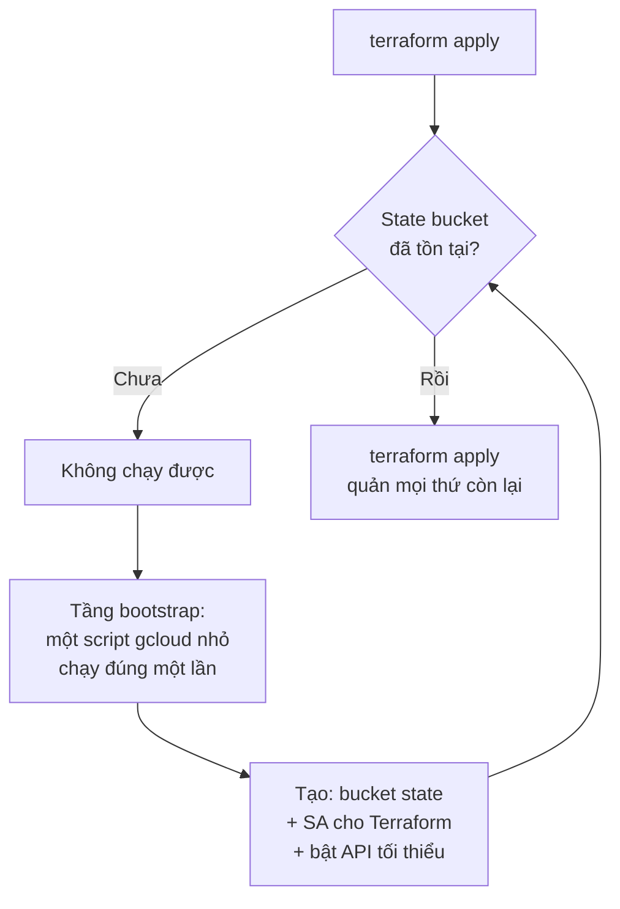
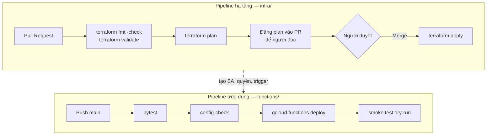
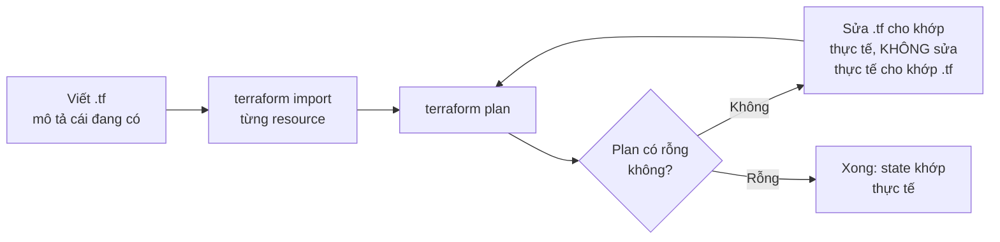

# Thiết kế CI/CD và Terraform

Thiết kế cho hai thứ đang thiếu ở project `elt-drive-to-bq`: **một quy trình
triển khai lặp lại được**, và **một bản mô tả hạ tầng bằng code**.

Tài liệu này không có code Terraform — nó trả lời *cấu trúc thế nào, ranh giới ở
đâu, thứ tự làm ra sao*. Code viết sau khi các quyết định dưới đây được chốt.

| Tài liệu liên quan | Nội dung |
|---|---|
| [CICD.md](../CICD.md) | Hướng dẫn thao tác CI/CD hiện tại (Cloud Build + GitHub) |
| [elt-drive-to-bq-decisions.md](elt-drive-to-bq-decisions.md) | Ngưỡng quyết định cho từng bước |
| [gcp-e2e-checklist.md](gcp-e2e-checklist.md) | Danh mục chuẩn bị hạ tầng |

---

## 1. Vấn đề đang có

Hạ tầng hiện tại được tạo ra bằng **ba cách khác nhau, rải qua nhiều phiên làm
việc**:

| Cách tạo | Ví dụ | Vấn đề |
|---|---|---|
| Script `gcloud` | dataset, service account, function | Có trong repo, nhưng chạy lại là bỏ qua lỗi chứ không phải hội tụ về trạng thái đúng |
| Gõ tay trong terminal | các lệnh `add-iam-policy-binding` vá lỗi 403 | **Không nằm ở đâu cả** |
| Bấm nút Console | Cloud Build trigger, kết nối GitHub | **Không nằm ở đâu cả** |

Hệ quả cụ thể, không phải giả định:

- Quyền `iam.serviceAccountUser` của compute SA **trên chính nó** chỉ được phát
  hiện là thiếu khi build đỏ. Không tài liệu nào nói nó cần có.
- Trigger Cloud Build tạo bằng Console thiếu hai trường (`file location`,
  `included files`) mà không ai biết cho tới khi build chạy sai.
- Không có cách nào trả lời câu "project này gồm những gì" ngoài việc đi mò từng
  trang Console.

Câu hỏi kiểm tra: **nếu project bị xoá sạch, dựng lại mất bao lâu?** Hiện tại câu
trả lời là *không biết* — và đó chính là định nghĩa của hạ tầng không quản lý được.

---

## 2. Ranh giới: Terraform quản gì, không quản gì

Đây là quyết định quan trọng nhất trong tài liệu. Terraform quản quá nhiều thì
mỗi lần deploy code cũng phải chạy `terraform apply`; quản quá ít thì lại quay về
click-ops.

```mermaid
flowchart LR
    subgraph TF["Terraform quản — thay đổi chậm"]
        A[Dataset, bảng ops]
        B[Service account + IAM]
        C[Cloud Build trigger]
        D[Cloud Scheduler job]
        E[Bucket, alert policy]
    end
    subgraph CD["CI/CD quản — thay đổi nhanh"]
        F[Mã nguồn function]
        G[Revision đang chạy]
        H[sources.yaml]
    end
    subgraph MAN["Không tự động hoá được"]
        I[Chia sẻ Google Sheet với SA]
        J[Kết nối GitHub với Cloud Build]
        K[Billing account]
    end

    TF -.->|tạo nền| CD
    MAN -.->|làm tay một lần| TF
```



### Nguyên tắc phân chia

**Terraform quản thứ thay đổi theo *tháng*.** Dataset, service account, phân
quyền, trigger, lịch chạy, cảnh báo. Những thứ này thay đổi hiếm, và mỗi lần thay
đổi đều đáng được review.

**CI/CD quản thứ thay đổi theo *ngày*.** Mã nguồn function và cấu hình tab. Đưa
chúng vào Terraform nghĩa là mỗi lần sửa một dòng Python phải chạy
`terraform apply` — biến việc 2 phút thành việc 10 phút, và làm `terraform plan`
lúc nào cũng có diff.

**Ranh giới cụ thể cho Cloud Function:** Terraform tạo *mọi thứ function cần để
tồn tại* (service account, quyền, dataset đích, trigger build, lịch chạy). CI/CD
tạo *bản thân function*. Nếu Terraform cũng quản resource
`google_cloudfunctions2_function` thì hai bên sẽ giành nhau: CI/CD deploy revision
mới, `terraform plan` lần sau báo drift và đòi đưa về bản cũ.

### Ba thứ không tự động hoá được

| Việc | Vì sao | Hệ quả thiết kế |
|---|---|---|
| Chia sẻ Sheet với service account | Là quyền Drive, không phải IAM | Phải có bước thủ công trong tài liệu, kèm `output` in ra email SA |
| Kết nối GitHub ↔ Cloud Build | Cần xác thực OAuth qua trình duyệt | Làm một lần, Terraform tham chiếu tới connection đã có |
| Billing account | Không thuộc phạm vi project | Điều kiện tiên quyết |

Terraform **không được giả vờ** quản ba thứ này. Thay vào đó nó phải *phát hiện
và báo lỗi rõ ràng* khi chúng chưa có.

---

## 3. Vấn đề con gà quả trứng

Terraform lưu state ở đâu? Nếu lưu trong GCS bucket, ai tạo bucket đó?



**Quyết định:** tách một tầng `bootstrap/` là **script shell, không phải
Terraform**. Nó tạo đúng ba thứ: bucket chứa state (bật versioning), service
account cho Terraform, và bật các API tối thiểu. Chạy một lần trong đời project.

Lý do không dùng Terraform cho tầng này: state của nó sẽ nằm ở đâu? Dùng local
state rồi commit vào git là cách phổ biến nhất và cũng tệ nhất — state Terraform
chứa giá trị nhạy cảm dưới dạng plaintext. Một script 20 dòng idempotent đơn giản
hơn và thành thật hơn.

---

## 4. Quản lý state

| Quyết định | Chọn | Lý do |
|---|---|---|
| Backend | GCS bucket cùng region | Có khoá (locking) sẵn, không cần thêm dịch vụ |
| Versioning | Bật | State hỏng là hỏng nặng; rollback được là bắt buộc |
| Mã hoá | Mặc định của Google | Đủ; CMEK chỉ cần khi có yêu cầu tuân thủ |
| Phân môi trường | Prefix khác nhau trong cùng bucket | Xem mục 5 |
| Ai được đọc state | Chỉ Terraform SA và owner | **State chứa bí mật ở dạng plaintext** |

Điểm cuối cùng đáng nhấn mạnh: state Terraform lưu mọi giá trị của mọi resource,
kể cả những trường nhạy cảm. Bucket chứa state phải được coi như một kho bí mật,
không phải một thư mục cấu hình bình thường.

---

## 5. Cấu trúc thư mục

```
infra/
├── bootstrap/
│   └── bootstrap.sh              # chạy một lần, tạo bucket state + TF SA
├── modules/
│   ├── bigquery/                 # dataset, bảng ops
│   ├── loader-function/          # SA + IAM + trigger + scheduler cho 1 loader
│   ├── cicd/                     # Cloud Build trigger
│   └── monitoring/               # alert policy, notification channel
└── envs/
    ├── dev/
    │   ├── main.tf               # gọi module, truyền biến của dev
    │   ├── backend.tf            # prefix = dev
    │   └── terraform.tfvars
    └── prod/
        ├── main.tf
        ├── backend.tf            # prefix = prod
        └── terraform.tfvars
```

### Vì sao tách `envs/` thay vì dùng workspace

Terraform workspace chia sẻ **cùng một file cấu hình** cho mọi môi trường, phân
biệt bằng biến. Nghe gọn nhưng có một nhược điểm nghiêm trọng: không nhìn được
`dev` và `prod` khác nhau chỗ nào nếu không đọc code có điều kiện.

Thư mục riêng thì `diff envs/dev/terraform.tfvars envs/prod/terraform.tfvars` trả
lời câu hỏi đó trong một giây. Đánh đổi là lặp code — được giải quyết bằng module.

**Với quy mô hiện tại (một người, một project), chỉ cần `envs/prod`.** Cấu trúc
này để sẵn chỗ cho `dev` khi có người thứ hai, không phải để dùng ngay.

### Vì sao module `loader-function` gộp SA + IAM + trigger + scheduler

Bốn resource này luôn đi cùng nhau. Thêm một loader mới nghĩa là cần cả bốn, và
quên một cái là lỗi 403 lúc 6h sáng. Gộp thành module nghĩa là thêm nguồn thứ hai
chỉ còn là một khối `module` với vài tham số.

Đây là hiện thân bằng Terraform của nguyên tắc config-driven đã nêu ở
[elt-drive-to-bq.md §9](elt-drive-to-bq.md).

---

## 6. Danh mục tài nguyên

Những gì Terraform sẽ quản, dựa trên hạ tầng thực tế đã dựng:

| Nhóm | Resource | Ghi chú |
|---|---|---|
| **API** | `google_project_service` × ~12 | Bật một lần; `disable_on_destroy = false` |
| **BigQuery** | `google_bigquery_dataset` × 4 | `core`, `staging`, `ops`, `bronze` (cũ) |
| | `google_bigquery_table` × 2 | `ops.load_runs`, `ops.schema_changes` — schema cố định |
| | Bảng SCD2 trong `core` | **Không quản** — function tự tạo theo sheet |
| **Danh tính** | `google_service_account` × 2 | `sheets-to-bq-loader`, `composer-runner` |
| | `google_project_iam_member` × ~10 | Quyền mức project |
| | `google_service_account_iam_member` × 3 | Quyền `actAs` — chỗ hay sai nhất |
| | `google_cloud_run_service_iam_member` | `run.invoker` cho Scheduler và build SA |
| **CI/CD** | `google_cloudbuild_trigger` × 2–3 | Gồm cả `included_files` |
| **Lịch** | `google_cloud_scheduler_job` × 1–2 | Kèm `time_zone` — hiện đang sai thành UTC |
| **Giám sát** | `google_monitoring_notification_channel` | Email |
| | `google_monitoring_alert_policy` × 3 | Fail, dữ liệu cũ, số dòng bất thường |
| **Chi phí** | `google_billing_budget` | Ngưỡng 50/90/100% |
| **State** | Bucket GCS | Do bootstrap tạo, Terraform không quản chính nó |

Điểm đáng chú ý: **ba `google_service_account_iam_member`** chính là ba lần lỗi
403 đã gặp. Viết chúng ra thành code là cách duy nhất để lần sau không phải khám
phá lại bằng cách nhìn build đỏ.

### Những thứ cố tình không đưa vào

| Không quản | Lý do |
|---|---|
| `google_cloudfunctions2_function` | CI/CD deploy; Terraform quản sẽ tạo drift mỗi lần push |
| Bảng SCD2 trong `core` | Schema do bảng tính quyết định, không do người viết Terraform |
| Cloud Composer environment | 300–500 USD/tháng — một `terraform apply` nhầm là rất đắt |
| Chia sẻ Google Sheet | Là quyền Drive, không có provider |

Mục Composer đáng nói thêm: về kỹ thuật thì `google_composer_environment` hoàn
toàn quản được. Lý do loại nó ra là *kinh tế, không phải kỹ thuật* — khi một
resource có chi phí gấp trăm lần phần còn lại cộng lại, việc tạo nó nên là một
hành động có chủ đích, không phải hệ quả phụ của `terraform apply`.

---

## 7. Hai pipeline



### Vì sao tách hai pipeline

Chúng khác nhau ở **mức độ nguy hiểm và nhịp độ**.

Pipeline ứng dụng chạy nhiều lần mỗi ngày, sai thì rollback bằng cách deploy lại
revision cũ — rẻ và nhanh. Pipeline hạ tầng chạy vài lần mỗi tháng, và một
`terraform apply` sai có thể xoá dataset. Hai thứ đó không nên dùng chung cổng
kiểm soát.

### Điểm mấu chốt: plan trên PR, apply sau khi merge

`terraform plan` đăng vào PR dưới dạng comment là cơ chế review hạ tầng duy nhất
có ý nghĩa. Nó trả lời câu hỏi "thay đổi này sẽ xoá cái gì" **trước khi** xoá.

Không bao giờ `apply` tự động trên PR. Không bao giờ `apply` mà không có plan được
người đọc.

---

## 8. Phân quyền cho Terraform

Terraform SA cần quyền **tạo và xoá** gần như mọi thứ trong project. Điều đó làm
nó trở thành danh tính mạnh nhất trong hệ thống — mạnh hơn cả build SA.

| Nguyên tắc | Cụ thể |
|---|---|
| Terraform SA ≠ build SA | Build SA deploy code, Terraform SA đổi hạ tầng. Gộp lại nghĩa là một lỗ hổng trong pipeline ứng dụng trở thành quyền xoá dataset |
| Không tạo key | Cloud Build chạy as Terraform SA; GitHub Actions dùng Workload Identity Federation |
| Quyền tối thiểu nhưng thực tế | `roles/editor` quá rộng, nhưng liệt kê 30 role lẻ thì mỗi resource mới lại thiếu quyền. Thoả hiệp: các role cụ thể ở mục 6 + quyền quản IAM |
| State bucket riêng quyền | Chỉ Terraform SA ghi được |

**Một cảnh báo về quyền quản IAM** (`roles/iam.securityAdmin` hoặc tương đương):
role này cho phép tự cấp thêm bất kỳ quyền nào. Nó cần thiết để Terraform quản
IAM, nhưng đồng nghĩa Terraform SA thực chất là owner. Đây là đánh đổi không
tránh được khi quản IAM bằng code — cách giảm thiểu là bảo vệ nhánh `main` và bắt
buộc review PR hạ tầng.

---

## 9. Cloud Build hay GitHub Actions cho pipeline hạ tầng

| Tiêu chí | Cloud Build | GitHub Actions |
|---|---|---|
| Xác thực GCP | Sẵn có | Cần Workload Identity Federation |
| Đăng `plan` vào PR | Phải tự viết bằng API GitHub | Có sẵn action |
| Cổng duyệt thủ công | Không có | Có (`environment` + reviewers) |
| Log nằm cạnh code | Không | Có |
| Chi phí | 2.500 phút/tháng miễn phí | 2.000 phút/tháng (repo private) |

**Đề xuất: GitHub Actions cho pipeline hạ tầng, Cloud Build cho pipeline ứng
dụng.**

Lý do không phải là sở thích: hai tính năng quyết định — *đăng plan vào PR* và
*cổng duyệt thủ công* — là bản chất của việc review hạ tầng, và GitHub Actions có
sẵn cả hai. Cloud Build thì phải tự dựng.

Ngược lại, pipeline ứng dụng đã chạy trên Cloud Build và không cần hai thứ đó.
Giữ nguyên.

Điều kiện bắt buộc nếu chọn GitHub Actions: **Workload Identity Federation, không
dùng file key**. Xem mục 8.

---

## 10. Di cư từ hiện trạng

Hạ tầng đã tồn tại. Chạy `terraform apply` trên cấu hình mới sẽ báo lỗi "resource
already exists" cho gần như mọi thứ.



**Tiêu chí hoàn thành duy nhất: `terraform plan` trả về "No changes".** Chừng nào
plan còn diff, Terraform chưa phản ánh đúng thực tế và mọi `apply` sau đó đều là
rủi ro.

Nguyên tắc trong lúc di cư: khi plan báo khác biệt, **sửa file `.tf` cho khớp hạ
tầng thật**, không phải chạy apply để ép hạ tầng khớp file. Hạ tầng đang chạy là
nguồn chân lý cho tới khi import xong.

Thứ tự import, từ ít rủi ro tới nhiều:

| Thứ tự | Nhóm | Vì sao trước |
|---|---|---|
| 1 | Dataset, API | Import sai cũng không ảnh hưởng gì đang chạy |
| 2 | Service account | Chưa động tới quyền |
| 3 | IAM binding | Chỗ dễ sai nhất — dùng `google_project_iam_member`, **không** dùng `google_project_iam_policy` |
| 4 | Trigger, Scheduler | Sửa sai thì chỉ mất một lần chạy |

Cảnh báo về mục 3: `google_project_iam_policy` **ghi đè toàn bộ** chính sách IAM
của project. Dùng nhầm nó thay vì `google_project_iam_member` là cách nhanh nhất
để tự khoá mình ra khỏi project.

---

## 11. Lộ trình

| Giai đoạn | Nội dung | Công sức | Giá trị |
|---|---|---|---|
| 1 | Bootstrap: bucket state + Terraform SA | 1 giờ | Mở đường cho mọi thứ sau |
| 2 | Import nhóm 1–2 (dataset, SA) | 2 giờ | Trả lời được "project gồm những gì" |
| 3 | Import nhóm 3 (IAM) | 3 giờ | **Ghi lại 3 quyền actAs đã phải mò ra** |
| 4 | Module `monitoring` — cảnh báo + budget | 2 giờ | Thứ đang thiếu hoàn toàn |
| 5 | Pipeline hạ tầng: plan trên PR | 3 giờ | Không còn apply mù |
| 6 | Import trigger + scheduler | 2 giờ | Hết click-ops |
| 7 | Module `loader-function` | 4 giờ | Thêm nguồn thứ hai chỉ còn vài dòng |

Giai đoạn 1–3 là phần đáng làm nhất: nó biến kiến thức đang nằm trong lịch sử chat
thành code trong repo.

Giai đoạn 4 đáng chú ý vì nó **không phải import** — cảnh báo và budget hiện chưa
tồn tại. Đây là lần đầu Terraform tạo ra thứ mới thay vì mô tả thứ cũ, và cũng là
hạng mục ưu tiên 1 trong [lộ trình hệ thống](elt-drive-to-bq.md).

---

## 12. Những quyết định đã chốt

| Quyết định | Chọn | Đánh đổi chấp nhận |
|---|---|---|
| Bootstrap bằng gì | Script shell, không phải Terraform | Một tầng không được quản bằng code |
| Backend state | GCS cùng region, bật versioning | Bucket này phải bảo mật như kho bí mật |
| Phân môi trường | Thư mục riêng, không dùng workspace | Lặp code, bù bằng module |
| Function code | CI/CD quản, Terraform không | Hai hệ thống cùng chạm một dịch vụ |
| Composer environment | Không đưa vào Terraform | Không lặp lại được tự động — có chủ ý |
| Pipeline hạ tầng | GitHub Actions + WIF | Thêm một hệ CI thứ hai phải hiểu |
| Pipeline ứng dụng | Giữ Cloud Build | Log tách khỏi GitHub |
| IAM resource type | `_iam_member`, không `_iam_policy` | Không thấy toàn cảnh IAM trong một file |
| Terraform SA quyền | Có quyền quản IAM | SA này thực chất là owner — bù bằng review PR |

---

## 13. Việc cần người quyết trước khi viết code

1. **Repo cho Terraform**: cùng repo `google_cloud_function` hay tách riêng? Cùng
   repo thì đơn giản hơn; tách riêng thì phân quyền rõ hơn (người sửa code
   function không tự động sửa được hạ tầng).
2. **Có làm môi trường `dev` không?** Hiện chỉ có một project. Nếu chưa cần, bỏ
   `envs/dev` để khỏi nuôi code chết.
3. **Email nhận cảnh báo** cho `notification_channel` ở giai đoạn 4.
4. **Giữ function cũ `sheet-to-bq-loader` hay xoá?** Nếu xoá thì không cần import
   dataset `bronze` và các quyền liên quan.
