# Cây quyết định và ngưỡng đánh giá — ELT Drive/Sheets → BigQuery

Tài liệu đồng hành với [`elt-drive-to-bq.md`](elt-drive-to-bq.md). Bản kia trả lời
*"hệ thống trông như thế nào"*; bản này trả lời *"tại từng bước, chọn cái gì, và
căn cứ vào con số nào để chọn"*.

Nguyên tắc dùng tài liệu:

- Mỗi mục là **một quyết định**, gồm: cây quyết định → bảng ngưỡng → mặc định khi
  chưa có số liệu.
- **Ngưỡng phải đo được**, không phải cảm tính. Nếu chưa đo được thì mục "Cách đo"
  cho biết lấy số ở đâu.
- Cột **"Vị trí hiện tại"** ghi rõ hệ thống thật đang nằm ở nhánh nào, tính đến
  2026-09-10.
- Khi số liệu nằm giữa hai ngưỡng: **chọn nhánh đơn giản hơn**. Chi phí của việc
  nâng cấp muộn thấp hơn chi phí vận hành một kiến trúc thừa.

Sơ đồ tổng hợp cả 12 quyết định trên một trang:
[`diagrams/elt-decision-map.drawio`](diagrams/elt-decision-map.drawio) (mở bằng
[draw.io](https://app.diagrams.net) hoặc extension "Draw.io Integration" trong VS Code)
— bản Mermaid tương đương: [`diagrams/elt-decision-map.mmd`](diagrams/elt-decision-map.mmd).

Bảng tra nhanh toàn bộ quyết định:

| # | Quyết định | Vị trí hiện tại | Ngưỡng chuyển nhánh gần nhất |
|---|---|---|---|
| 1 | Nền tảng chạy job nạp | Cloud Function gen2 | >9 phút/lần chạy hoặc >2 GB RAM |
| 2 | Cơ chế kích hoạt | Cloud Scheduler (chưa bật) | SLA <15 phút → event-driven |
| 3 | Chế độ trích xuất | Full extract | >50k dòng hoặc >120 giây đọc |
| 4 | Xử lý schema | Hardcode trong code | Nguồn thứ 2 hoặc lần đổi cột thứ 2 |
| 5 | Chế độ ghi bronze | WRITE_TRUNCATE | **Đã vượt ngưỡng — cần đổi ngay** |
| 6 | Phân vùng / clustering | Không có | >1 GB hoặc >10 triệu dòng |
| 7 | Công cụ biến đổi | Chưa có (chỉ bronze) | ≥3 bảng dẫn xuất → Dataform |
| 8 | Điều phối | Không có | ≥3 nguồn hoặc có phụ thuộc chéo |
| 9 | Giám sát & cảnh báo | Không có | **Đã vượt ngưỡng — cần làm ngay** |
| 10 | Chặn chi phí | Không có | >5 USD/ngày truy vấn |
| 11 | Phạm vi phân quyền | dataEditor toàn project | Có PII hoặc >1 nhóm người dùng |
| 12 | CI/CD và môi trường | Deploy thủ công | ≥2 người sửa code |

---

## 1. Nền tảng chạy job nạp

### Cây quyết định

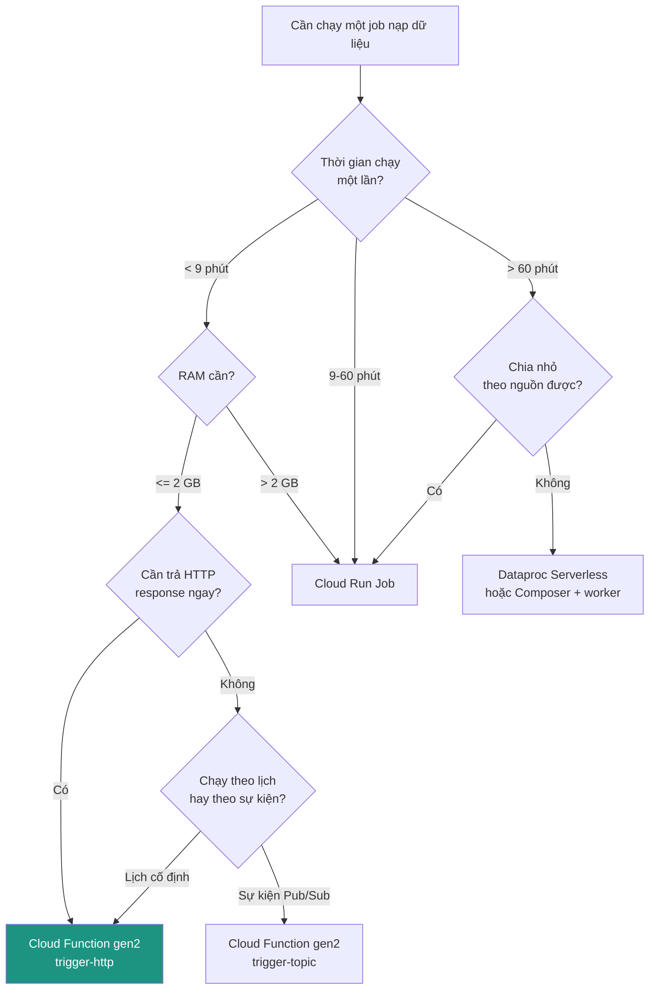

### Ngưỡng đánh giá

| Tiêu chí | Cloud Function gen2 | Cloud Run Job | Dataproc Serverless |
|---|---|---|---|
| Timeout tối đa | 60 phút (HTTP: 60 phút; thực tế nên ≤9 phút) | 24 giờ | Không giới hạn thực tế |
| RAM tối đa | 32 GB (gói thường dùng 256 MB–2 GB) | 32 GB | Theo cluster |
| Khởi động nguội | 2–8 giây | 5–15 giây | 60–90 giây |
| Chi phí khi rảnh | 0 | 0 | 0 (serverless) |
| Độ phức tạp vận hành | Thấp nhất | Trung bình | Cao |
| Hợp khi | 1 sheet, <50k dòng | Nhiều sheet trong 1 lần chạy | Join/aggregate ngoài BQ |

### Cách đo

```bash
# Thời gian chạy thực tế của các lần gọi gần đây
gcloud functions logs read sheet-to-bq-loader --region=asia-southeast1 --limit=50 \
  | grep "Function execution took"

# Bộ nhớ đỉnh — Cloud Monitoring metric
# run.googleapis.com/container/memory/utilizations
```

**Ngưỡng cảnh báo sớm:** khi thời gian chạy vượt **50% timeout đã cấu hình**
(hiện là 120 giây → cảnh báo ở 60 giây), bắt đầu lên kế hoạch chuyển. Đừng đợi
đến lúc timeout thật vì lúc đó job đã fail và không có dữ liệu.

**Vị trí hiện tại:** Cloud Function gen2, 256 MB, timeout 120s, xử lý 1 dòng. Còn
rất xa mọi ngưỡng — giữ nguyên là đúng.

---

## 2. Cơ chế kích hoạt

### Cây quyết định

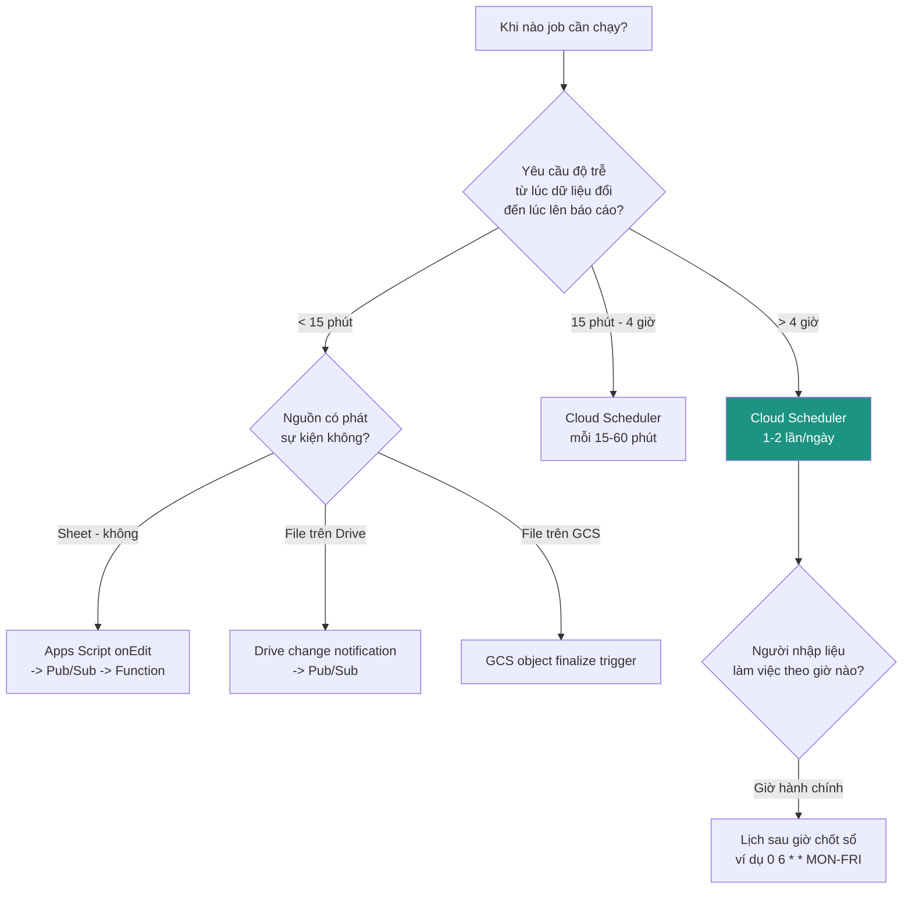

### Ngưỡng đánh giá

| Độ trễ chấp nhận được | Cơ chế | Chi phí/tháng ước tính | Rủi ro |
|---|---|---|---|
| ≥ 1 ngày | Scheduler 1 lần/ngày | ~0 USD | Lỗi phát hiện muộn 24h |
| 4–24 giờ | Scheduler 2–4 lần/ngày | ~0 USD | Thấp |
| 1–4 giờ | Scheduler mỗi giờ | <1 USD | Đọc Sheet 720 lần/tháng, an toàn |
| 15–60 phút | Scheduler mỗi 15 phút | <1 USD | Sát quota Sheets API nếu nhiều nguồn |
| < 15 phút | Event-driven | Thay đổi theo lượng edit | Apps Script bắn liên tục khi có người đang gõ |

**Quota cần biết:** Sheets API cho phép **300 request/phút/project** và
**60 request/phút/user**. Với N nguồn chạy mỗi X phút, số request/phút ≈ N/X. Chỉ
chạm quota khi N/X > 60 — ví dụ 60 nguồn chạy mỗi phút. Xa vời với quy mô hiện tại.

**Bẫy của event-driven trên Sheet:** người dùng gõ 20 ô liên tiếp sẽ tạo 20 sự
kiện. Bắt buộc phải có **debounce** (gom sự kiện trong cửa sổ 5–10 phút) nếu chọn
nhánh này — nếu không sẽ nạp 20 lần cho 1 lần sửa.

**Vị trí hiện tại:** lệnh Scheduler `0 6 * * MON-FRI` đã có trong
[`deploy.sh`](../functions/sheet_to_bq_loader/deploy.sh) bước 8 nhưng **chưa xác nhận
đã chạy**. Cần kiểm tra:

```bash
gcloud scheduler jobs list --location=asia-southeast1
```

---

## 3. Chế độ trích xuất: full vs incremental

### Cây quyết định

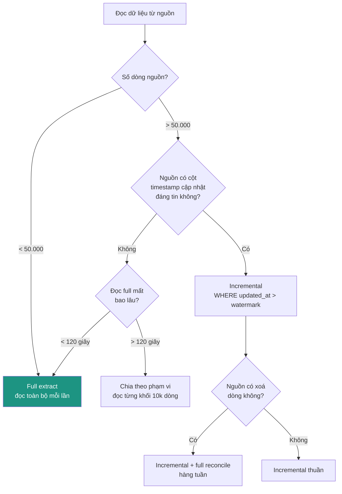

### Ngưỡng đánh giá

| Chỉ số | Full extract an toàn khi | Cân nhắc incremental khi |
|---|---|---|
| Số dòng | < 50.000 | > 50.000 |
| Thời gian đọc Sheet | < 120 giây | > 120 giây |
| Kích thước payload | < 50 MB | > 50 MB (Sheets API trả JSON, nở ~3–5× so với CSV) |
| Tần suất chạy | Bất kỳ | Chạy > 4 lần/ngày và dữ liệu lớn |

**Lý do ngưỡng 50.000:** Sheets API trả về một response JSON duy nhất. Ở khoảng
50k dòng × 10 cột, payload đã ~30–50 MB và thời gian đọc 30–90 giây — vẫn vừa
timeout nhưng bắt đầu sát. Đây là điểm nên chuẩn bị, chưa phải điểm bắt buộc đổi.

**Điều quan trọng hơn ngưỡng:** với Google Sheets, **incremental gần như luôn là
lựa chọn tệ**. Sheet không có transaction log, không có cột `updated_at` đáng tin
(người dùng sửa ô mà không sửa cột ngày), và cho phép xoá dòng không dấu vết. Full
extract + append-only ở bronze cho lịch sử đầy đủ mà không cần tin vào metadata do
người dùng nhập. Chỉ chuyển sang incremental khi nguồn đã rời khỏi Sheet (sang
database thật) hoặc dữ liệu vượt xa ngưỡng trên.

**Vị trí hiện tại:** full extract, 1 dòng. Đúng nhánh.

---

## 4. Xử lý schema

### Cây quyết định

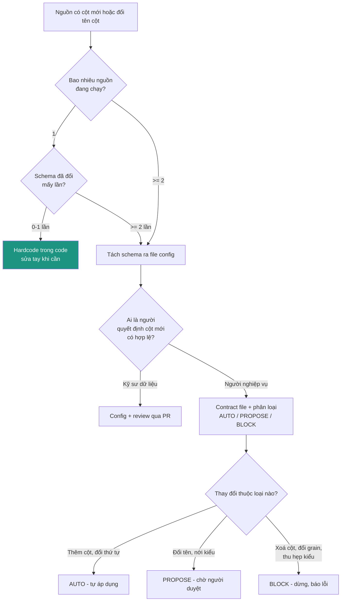

### Ngưỡng đánh giá

| Tín hiệu | Ngưỡng chuyển sang config-driven |
|---|---|
| Số nguồn | ≥ 2 |
| Số lần sửa code chỉ để đổi schema | ≥ 2 lần |
| Thời gian từ lúc nghiệp vụ báo đổi cột đến lúc deploy xong | > 1 ngày |
| Số người cần sửa schema mà không biết Python | ≥ 1 |

Bảng phân loại thay đổi (nếu đi tới nhánh contract) — chi tiết đầy đủ ở
[`schema-evolution.md`](schema-evolution.md):

| Loại thay đổi | Hành động | Vì sao |
|---|---|---|
| Thêm cột mới | AUTO | Không phá gì đang chạy |
| Đổi thứ tự cột | AUTO | Đọc theo tên, không theo vị trí |
| Nới kiểu (INT → FLOAT → STRING) | AUTO | Không mất thông tin |
| Đổi tên cột, độ giống ≥ 0.5 | PROPOSE | Máy đoán được nhưng có thể đoán sai |
| Xoá cột đang dùng | BLOCK | Báo cáo dưới hạ nguồn sẽ vỡ |
| Thu hẹp kiểu (STRING → INT) | BLOCK | Mất dữ liệu im lặng |
| Đổi khoá/grain | BLOCK | Mọi phép đếm phía sau sai |

**Vị trí hiện tại:** hardcode — `CANONICAL_COLUMNS = ("id", "name")` trong
[`main.py`](../functions/sheet_to_bq_loader/main.py). Với 1 nguồn 2 cột chưa từng
đổi, đây vẫn là lựa chọn đúng. **Nguồn thứ hai là tín hiệu chuyển nhánh** — đừng
copy function.

---

## 5. Chế độ ghi vào bronze

### Cây quyết định

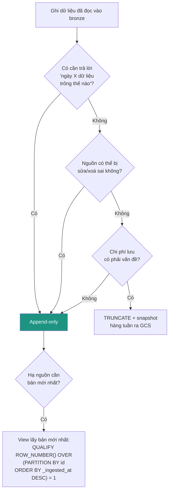

### Ngưỡng đánh giá

Chi phí lưu trữ BigQuery: **~0,02 USD/GB/tháng** (active), **~0,01 USD/GB/tháng**
(long-term, sau 90 ngày không sửa).

| Số dòng/lần nạp | Tần suất | Dữ liệu tích luỹ 1 năm | Chi phí lưu/năm |
|---|---|---|---|
| 1.000 | 1 lần/ngày | ~365k dòng ≈ 40 MB | < 0,01 USD |
| 10.000 | 1 lần/ngày | ~3,6 triệu dòng ≈ 400 MB | ~0,08 USD |
| 100.000 | 1 lần/ngày | ~36 triệu dòng ≈ 4 GB | ~0,80 USD |
| 100.000 | 24 lần/ngày | ~876 triệu dòng ≈ 96 GB | ~19 USD |

**Kết luận từ bảng:** chi phí lưu **không phải lý do** để chọn `WRITE_TRUNCATE` ở
quy mô dưới hàng chục triệu dòng/ngày. Ngưỡng thực tế mà chi phí bắt đầu đáng cân
nhắc là khoảng **10 GB/tháng tăng thêm** (~2,4 USD/năm mỗi tháng cộng dồn) — và
ngay cả khi đó, cách xử lý đúng là đặt **partition expiration** (ví dụ giữ 90
ngày), không phải xoá sạch mỗi lần chạy.

**Vị trí hiện tại — đã vượt ngưỡng.** Bảng `bronze.brz_customer` đang dùng
`WRITE_TRUNCATE`. Mỗi lần chạy xoá toàn bộ lịch sử. Với 1 dòng dữ liệu thì chi phí
lưu append-only là **0 USD** — không có lý do kinh tế nào biện minh cho việc giữ
TRUNCATE. Đây là hạng mục ưu tiên 2 trong lộ trình
[`elt-drive-to-bq.md` §10](elt-drive-to-bq.md).

**Ngoại lệ hợp lệ duy nhất của TRUNCATE:** bảng ở tầng gold được dựng lại hoàn
toàn từ silver mỗi lần chạy. Ở đó TRUNCATE là đúng vì nguồn để dựng lại vẫn còn
nguyên.

---

## 6. Phân vùng và clustering

### Cây quyết định

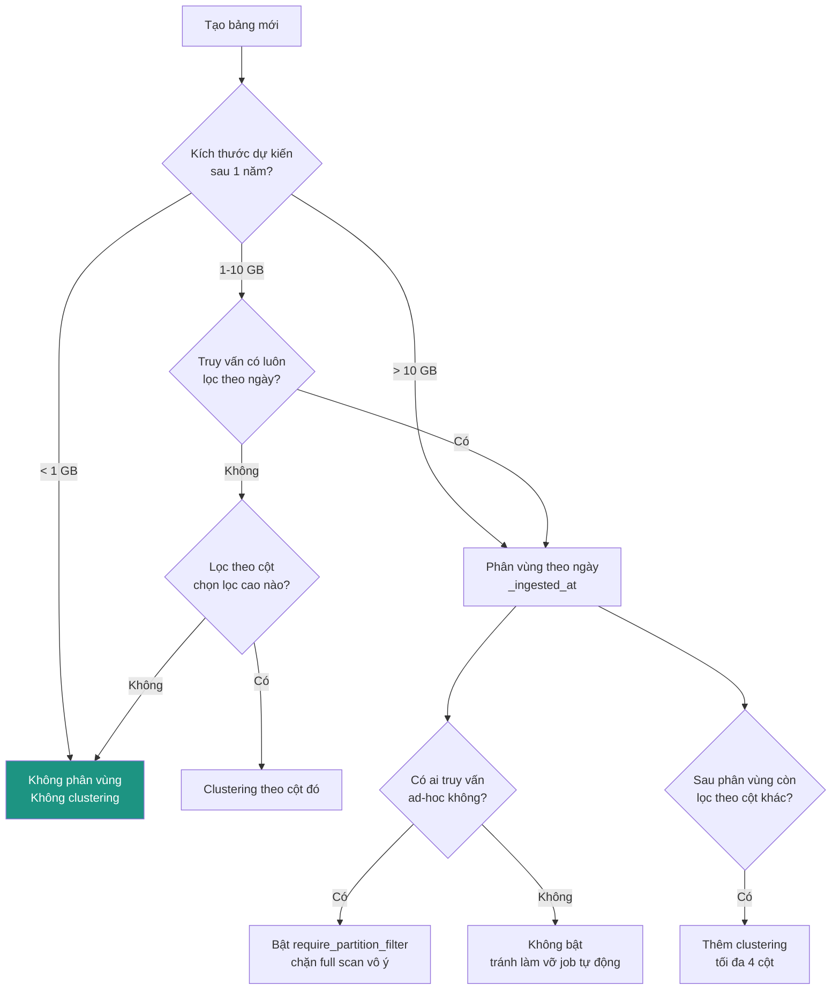

### Ngưỡng đánh giá

| Chỉ số | Ngưỡng | Lý do |
|---|---|---|
| Kích thước bảng | < 1 GB → bỏ qua | Quét toàn bảng 1 GB tốn ~0,005 USD và <1 giây. Tối ưu không đáng công. |
| Số partition | Tối đa 4.000/bảng | Phân vùng theo ngày = ~11 năm. Theo giờ chỉ đủ 166 ngày — chỉ dùng khi thật cần. |
| Kích thước 1 partition | Nên ≥ 100 MB | Partition quá nhỏ (<10 MB) làm metadata nặng hơn lợi ích. |
| Số cột clustering | Tối đa 4 | Thứ tự cột quan trọng: đặt cột lọc nhiều nhất trước. |
| Độ chọn lọc để clustering đáng làm | Cột lọc ra < 10% số dòng | Lọc ra 50% thì clustering gần như vô ích. |

### Cách đo trước khi quyết định

```sql
-- Kích thước và số dòng thực tế của các bảng
SELECT table_id,
       row_count,
       ROUND(size_bytes/POW(1024,3), 3) AS size_gb
FROM `elt-drive-to-bq.bronze.__TABLES__`
ORDER BY size_bytes DESC;

-- Truy vấn nào tốn nhiều byte nhất trong 30 ngày qua
SELECT user_email,
       ROUND(SUM(total_bytes_billed)/POW(1024,3), 2) AS gb_billed,
       COUNT(*) AS n_queries
FROM `region-asia-southeast1`.INFORMATION_SCHEMA.JOBS
WHERE creation_time > TIMESTAMP_SUB(CURRENT_TIMESTAMP(), INTERVAL 30 DAY)
  AND job_type = 'QUERY'
GROUP BY user_email
ORDER BY gb_billed DESC;
```

**Vị trí hiện tại:** bảng có 1 dòng, không phân vùng — đúng. Nhưng khi chuyển sang
append-only (mục 5), **hãy tạo bảng mới có sẵn phân vùng theo `_ingested_at`** ngay
từ đầu. Thêm phân vùng cho bảng đã có dữ liệu đòi hỏi tạo bảng mới và copy — làm
lúc bảng còn trống thì miễn phí.

---

## 7. Công cụ biến đổi (bronze → silver → gold)

### Cây quyết định

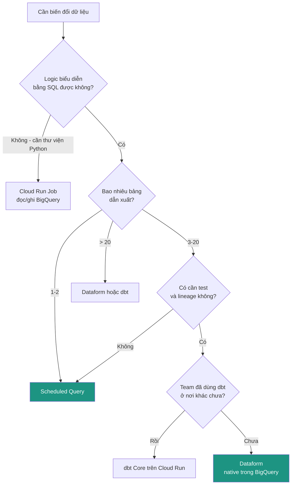

### Ngưỡng đánh giá

| Tiêu chí | Scheduled Query | Dataform | dbt Core |
|---|---|---|---|
| Số bảng hợp lý | 1–2 | 3–200 | 3–1000+ |
| Chi phí công cụ | 0 | 0 (đã gồm trong BQ) | 0 (Core) + hạ tầng chạy |
| Quản lý phụ thuộc | Thủ công (tự đặt lịch lệch nhau) | Tự động theo `ref()` | Tự động theo `ref()` |
| Test dữ liệu | Không | Có (assertions) | Có |
| Lineage | Không | Có, trong Console | Có, cần docs site |
| Version control | Có (khó — nằm trong Console) | Có, gắn Git | Có |
| Đa kho dữ liệu | Không | Chỉ BigQuery | Có |
| Thời gian học | 0 | ~1 ngày | ~3 ngày |

**Ngưỡng chuyển từ Scheduled Query sang Dataform: bảng thứ 3.** Lý do là quản lý
phụ thuộc. Với 2 bảng, đặt lịch A lúc 6:00 và B lúc 6:15 là chấp nhận được. Với 3+
bảng có phụ thuộc chéo, cách này bắt đầu tạo lỗi im lặng: B chạy trước khi A xong
sẽ đọc dữ liệu cũ mà không báo lỗi gì.

**Ngưỡng chọn dbt thay Dataform:** chỉ khi có kho dữ liệu thứ hai ngoài BigQuery,
hoặc team đã có sẵn kỹ năng dbt. Nếu chỉ dùng BigQuery, Dataform ít hạ tầng phải
nuôi hơn — nó chạy trong BigQuery, không cần Cloud Run/Composer để thực thi.

**Vị trí hiện tại:** chưa có tầng biến đổi nào. Bảng dẫn xuất đầu tiên nên là
Scheduled Query; bắt đầu chuẩn bị Dataform khi lên bảng thứ 3.

---

## 8. Điều phối

### Cây quyết định

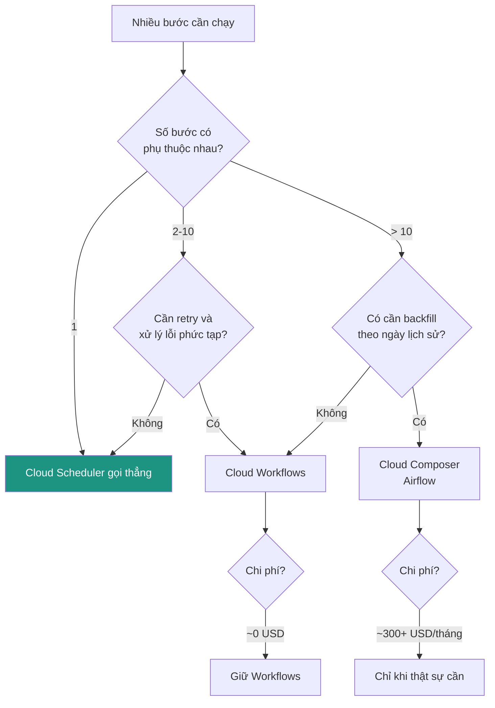

### Ngưỡng đánh giá

| Chỉ số | Scheduler đơn | Workflows | Composer |
|---|---|---|---|
| Số bước | 1 | 2–50 | 50+ |
| Số nguồn dữ liệu | 1–2 | 3–20 | 20+ |
| Chi phí cố định/tháng | ~0 USD | ~0 USD (0,01 USD/1000 bước) | **300–500 USD** |
| Backfill lịch sử | Thủ công | Thủ công | Có sẵn |
| Giao diện xem DAG | Không | Có (đơn giản) | Có (đầy đủ) |
| Thời gian dựng | Phút | Giờ | Ngày |

**Ngưỡng quan trọng nhất là chi phí Composer.** Một môi trường Composer nhỏ nhất
tốn khoảng **300–500 USD/tháng kể cả khi không chạy gì**. So với toàn bộ chi phí
hiện tại của hệ thống này (gần như 0 USD), đó là một bậc thang rất dốc. Quy tắc:
**không dùng Composer cho đến khi Workflows thực sự không đủ** — và với dưới 20
nguồn, Workflows gần như luôn đủ.

**Ngưỡng chuyển từ Scheduler sang Workflows: nguồn thứ 3, hoặc lần đầu có phụ
thuộc chéo.** Phụ thuộc chéo là dấu hiệu mạnh hơn số lượng: hai job độc lập chạy
song song không cần điều phối, nhưng chỉ cần một job phải đợi job khác xong là
việc đặt lịch lệch giờ trở thành nợ kỹ thuật.

**Vị trí hiện tại:** 1 nguồn, không phụ thuộc. Scheduler đơn là đủ.

---

## 9. Giám sát và cảnh báo

### Cây quyết định

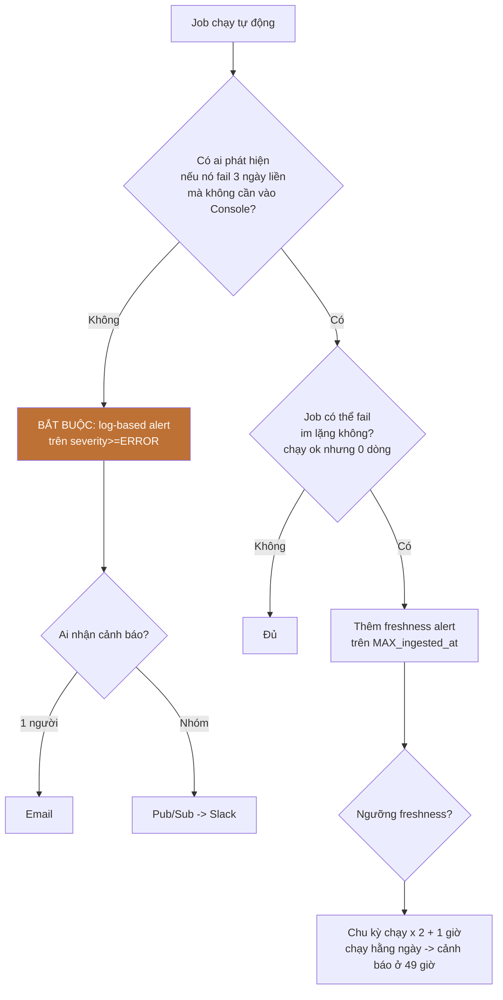

### Ba cảnh báo tối thiểu và ngưỡng của chúng

| Cảnh báo | Điều kiện | Ngưỡng | Vì sao ngưỡng đó |
|---|---|---|---|
| **Job fail** | Log có `severity>=ERROR` từ function | Ngay lần đầu, cửa sổ 5 phút | Fail là bất thường tuyệt đối, không cần chờ tích luỹ |
| **Dữ liệu cũ** | `MAX(_ingested_at)` quá cũ | Chu kỳ × 2 + 1 giờ | Cho phép trượt 1 lần chạy mà không báo động giả |
| **Số dòng bất thường** | Số dòng nạp lệch so với trung bình 7 ngày | Ngoài khoảng ±50%, hoặc = 0 | ±50% đủ rộng để không nhiễu, đủ hẹp để bắt sheet bị xoá |

**Ngưỡng freshness tính thế nào:** chạy hằng ngày lúc 6:00 → dữ liệu bình thường
tối đa 24 giờ tuổi. Cảnh báo ở 24×2+1 = **49 giờ** nghĩa là bỏ lỡ 2 lần chạy liên
tiếp mới báo. Đặt ở 25 giờ sẽ báo động giả mỗi lần job trễ vài phút.

**Ngưỡng ±50% cho số dòng:** rộng hơn so với chuẩn ±20% thường thấy, vì dữ liệu do
người nhập tay biến động mạnh theo ngày (thứ Hai nhiều hơn thứ Sáu). Bắt đầu từ
±50%, thu hẹp dần sau khi có 30 ngày số liệu thật để biết độ biến động thực tế.

**Cách đo để đặt ngưỡng đúng:**

```sql
-- Số dòng nạp mỗi ngày, dùng để xác định biên độ dao động thật
SELECT DATE(_ingested_at) AS d, COUNT(*) AS rows_loaded
FROM `elt-drive-to-bq.bronze.brz_customer`
GROUP BY d ORDER BY d DESC LIMIT 30;
```

**Vị trí hiện tại — đã vượt ngưỡng.** Không có cảnh báo nào. Câu hỏi ở gốc cây
("có ai phát hiện nếu fail 3 ngày liền không?") hiện có câu trả lời là **không**.
Đây là hạng mục ưu tiên 1 trong lộ trình.

---

## 10. Chặn chi phí

### Cây quyết định

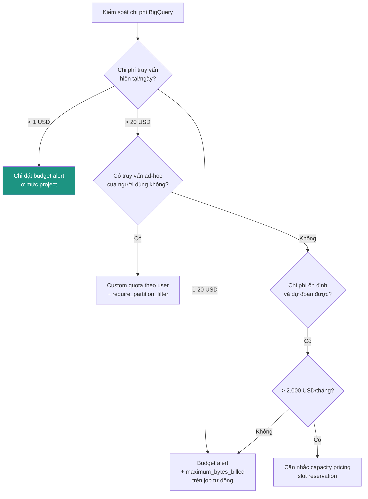

### Ngưỡng đánh giá

Giá on-demand: **~6,25 USD/TB quét** (asia-southeast1, tham khảo — kiểm tra lại
bảng giá hiện hành). 1 GB quét ≈ 0,006 USD.

| Chi phí truy vấn/tháng | Hành động | Công cụ |
|---|---|---|
| < 30 USD | Budget alert 50/90/100% | Cloud Billing budget |
| 30–200 USD | + `maximum_bytes_billed` trên mọi job tự động | Đặt trong QueryJobConfig |
| 200–2.000 USD | + custom quota theo user, + `require_partition_filter` | BigQuery admin |
| > 2.000 USD | Đánh giá slot reservation | Editions pricing |

**Ngưỡng slot reservation ~2.000 USD/tháng:** một reservation 100 slot Standard
Edition tốn khoảng 2.000–2.500 USD/tháng. Chuyển sang capacity pricing chỉ có lãi
khi chi phí on-demand đã vượt mức đó **và** tải ổn định. Tải bất thường (một tháng
cao, tháng sau thấp) thì on-demand vẫn rẻ hơn.

**`maximum_bytes_billed` đặt bao nhiêu:** lấy lượng byte của lần chạy bình thường
× 3. Nếu một truy vấn thường quét 500 MB thì đặt trần 1,5 GB — đủ chỗ cho dữ liệu
tăng tự nhiên nhưng chặn được một `SELECT *` viết sai quét cả bảng.

```sql
-- Byte thực tế mỗi truy vấn đã dùng, để đặt trần đúng
SELECT job_id,
       ROUND(total_bytes_billed/POW(1024,2), 1) AS mb_billed,
       query
FROM `region-asia-southeast1`.INFORMATION_SCHEMA.JOBS
WHERE creation_time > TIMESTAMP_SUB(CURRENT_TIMESTAMP(), INTERVAL 7 DAY)
  AND job_type = 'QUERY'
ORDER BY total_bytes_billed DESC LIMIT 20;
```

**Vị trí hiện tại:** chi phí gần như bằng 0 (1 dòng dữ liệu). Chỉ cần budget alert
— nhưng nên đặt **ngay bây giờ**, vì budget alert là thứ bảo vệ khỏi sự cố bất ngờ,
và lúc chi phí đang thấp thì không ai nhớ đặt.

---

## 11. Phạm vi phân quyền

### Cây quyết định

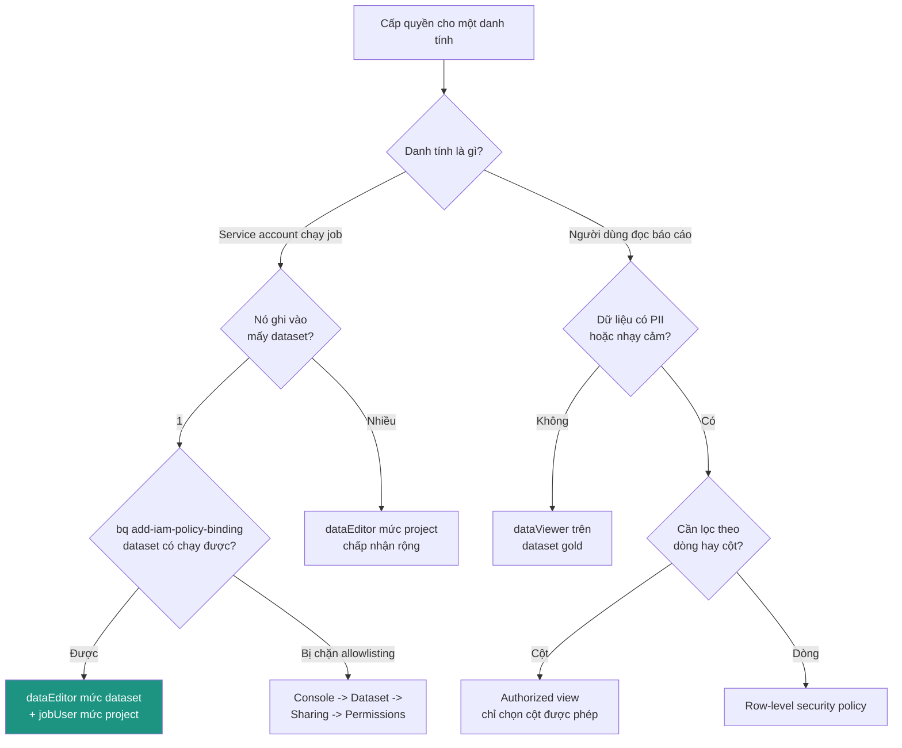

### Ngưỡng đánh giá

| Tình huống | Phạm vi quyền đúng |
|---|---|
| 1 SA ghi 1 dataset | dataEditor **mức dataset** |
| 1 SA ghi 3+ dataset | dataEditor mức project (chấp nhận đánh đổi) |
| Người dùng đọc báo cáo | dataViewer trên **gold**, không bao giờ trên bronze |
| 1 nhóm người dùng, không PII | dataViewer dataset là đủ |
| 2+ nhóm, khác quyền xem | Authorized view cho mỗi nhóm |
| Có PII (tên, email, số điện thoại) | Column-level security hoặc masking |
| Mỗi người chỉ xem dữ liệu vùng mình | Row-level security |

**Ba điều dễ sai — rút ra từ quá trình debug thực tế**
([`deployment-log.md`](../functions/sheet_to_bq_loader/deployment-log.md)):

1. **Quyền đọc Google Sheet không phải IAM.** Không có role GCP nào cấp được. Phải
   vào Sheet → Share → thêm email service account làm Viewer. Không có ngưỡng, không
   có lựa chọn thay thế — bước thủ công bắt buộc mỗi lần thêm nguồn.
2. **BigQuery tách "ghi dữ liệu" và "chạy job".** `dataEditor` cho phép ghi vào
   bảng; `jobUser` cho phép tạo job để thực hiện việc ghi đó. Thiếu một trong hai
   đều lỗi 403, nhưng thông báo lỗi khác nhau — đọc kỹ tên permission bị từ chối.
3. **SA build khác SA runtime.** Trong project này Cloud Build thực tế chạy bằng
   `{PROJECT_NUMBER}-compute@developer.gserviceaccount.com`, không phải
   `{PROJECT_NUMBER}@cloudbuild.gserviceaccount.com`. Xác định đúng:
   Console → Cloud Build → Triggers → mở trigger → mục "Service account".

**Vị trí hiện tại:** `dataEditor` **mức project** — rộng hơn mức lý tưởng. Lý do đã
ghi nhận: `bq add-iam-policy-binding` trên dataset trả về "This feature requires
allowlisting" trên project này. Đường thu hẹp lại: Console → dataset `bronze` →
Sharing → Permissions (giao diện Console không bị giới hạn CLI này). Chưa cấp bách
vì chưa có PII và chỉ có 1 người dùng, nhưng nên làm trước khi thêm người dùng thứ hai.

---

## 12. CI/CD và tách môi trường

### Cây quyết định

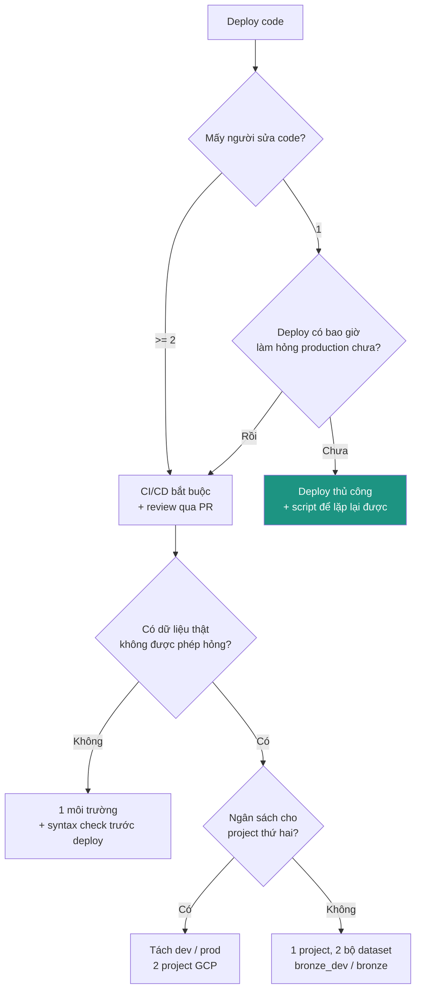

### Ngưỡng đánh giá

| Tín hiệu | Ngưỡng | Hành động |
|---|---|---|
| Số người sửa code | ≥ 2 | CI/CD + PR review |
| Số lần deploy/tháng | ≥ 4 | CI/CD (thủ công bắt đầu tốn thời gian) |
| Số sự cố do deploy | ≥ 1 | CI/CD + syntax/test gate |
| Dữ liệu production có người phụ thuộc | Có | Tách môi trường |
| Thời gian deploy thủ công | > 10 phút/lần | CI/CD |

**Ngưỡng tách môi trường riêng biệt:** tách 2 project GCP chỉ đáng khi có **người
dùng thật đang phụ thuộc vào dữ liệu production**. Trước đó, tách bằng tiền tố
dataset (`bronze_dev` vs `bronze`) trong cùng project rẻ hơn nhiều mà vẫn đủ an
toàn — không phải nhân đôi cấu hình IAM, không phải quản lý 2 bộ service account.

**Vị trí hiện tại:** 1 người, deploy thủ công, **chưa có git repo** (`git status`
báo `fatal: not a git repository`). CI/CD đã được thiết kế đầy đủ trong
[`cicd-setup.md`](../functions/sheet_to_bq_loader/cicd-setup.md) và
[`cloudbuild.yaml`](../functions/sheet_to_bq_loader/cloudbuild.yaml) nhưng **chưa
thực thi bước nào**.

Theo cây quyết định, với 1 người và chưa từng có sự cố deploy, nhánh đúng vẫn là
"deploy thủ công + script lặp lại được" — và [`deploy.sh`](../functions/sheet_to_bq_loader/deploy.sh)
đã đáp ứng điều đó. Tuy nhiên **`git init` nên làm ngay bất kể CI/CD**: version
control giải quyết vấn đề khác (lịch sử thay đổi, khôi phục khi sửa hỏng), không
phụ thuộc vào ngưỡng nào ở trên.

---

## Tổng hợp: việc nên làm theo thứ tự

Sắp theo *(đã vượt ngưỡng) trước, (giá trị ÷ công sức)* sau:

| Thứ tự | Việc | Trạng thái ngưỡng | Công sức |
|---|---|---|---|
| 1 | Cảnh báo khi job fail (mục 9) | **Đã vượt** | ~1 giờ |
| 2 | Bronze append-only + phân vùng (mục 5, 6) | **Đã vượt** | ~3 giờ |
| 3 | `git init` + push lên remote (mục 12) | Không phụ thuộc ngưỡng | ~30 phút |
| 4 | Xác nhận Cloud Scheduler đã bật (mục 2) | Chưa xác minh | ~15 phút |
| 5 | Budget alert (mục 10) | Chưa vượt, nhưng rẻ | ~15 phút |
| 6 | Thu hẹp dataEditor về mức dataset (mục 11) | Chưa vượt | ~30 phút |
| 7 | Tách schema ra config (mục 4) | Chờ nguồn thứ 2 | ~1 ngày |
| 8 | Dataform (mục 7) | Chờ bảng dẫn xuất thứ 3 | ~1 ngày |
| 9 | Workflows (mục 8) | Chờ nguồn thứ 3 | ~1 ngày |
| 10 | CI/CD trigger (mục 12) | Chờ người thứ 2 | ~2 giờ |

Mục 1–5 làm được ngay với quy mô hiện tại. Mục 6–10 **cố tình chưa làm** — làm sớm
là tạo hạ tầng thừa phải nuôi mà chưa có ai dùng.

> Ghi chú về số liệu giá: các con số USD trong tài liệu là mức tham khảo tại thời
> điểm viết (2026-09-10) cho vùng `asia-southeast1`. Chúng dùng để **so sánh bậc độ
> lớn giữa các lựa chọn**, không dùng để lập dự toán — kiểm tra bảng giá hiện hành
> của Google Cloud trước khi cam kết ngân sách.
