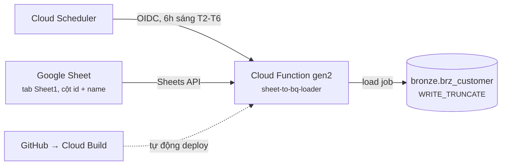
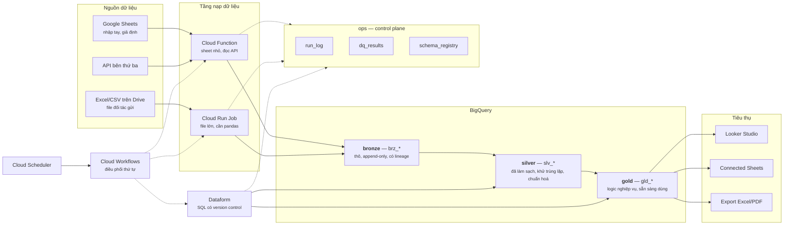
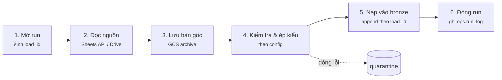

# Thiết kế hệ thống — ELT từ Google Drive/Sheets vào BigQuery

Thiết kế kiến trúc cho hệ thống đang chạy trên project `elt-drive-to-bq`. Tài liệu
này mô tả **hiện trạng thật**, những chỗ sẽ vỡ khi mở rộng, và **kiến trúc mục tiêu**
— không bao gồm code.

| | |
|---|---|
| **Project** | `elt-drive-to-bq` |
| **Đang chạy** | 1 Google Sheet → Cloud Function → `bronze.brz_customer` |
| **Mục tiêu** | N nguồn → ingestion điều khiển bằng config → bronze/silver/gold → BI |
| **Tài liệu liên quan** | [elt-drive-to-bq-decisions.md](elt-drive-to-bq-decisions.md) (cây quyết định + ngưỡng), [gcp-e2e-checklist.md](gcp-e2e-checklist.md) (chuẩn bị hạ tầng), [deployment-log.md](../functions/sheet_to_bq_loader/deployment-log.md) (lịch sử debug), [cicd-setup.md](../functions/sheet_to_bq_loader/cicd-setup.md) (CI/CD) |

---

## 1. Hiện trạng

**Những gì đã đúng và nên giữ:**

- Không có key file service account nào — dùng ADC lúc runtime, OIDC cho Scheduler. Đây là điểm bảo mật quan trọng nhất và đã làm đúng ngay từ đầu.
- Mỗi dòng đều có `_load_id` và `_ingested_at` — có sẵn nền tảng để truy vết.
- Function không public (`--no-allow-unauthenticated`), chỉ identity được cấp quyền mới gọi được.
- CI/CD đã tự động hoá deploy, không còn deploy tay.

---

## 2. Hiện trạng sẽ vỡ ở đâu

Bốn vấn đề, xếp theo mức độ cấp thiết:

| # | Vấn đề | Hậu quả khi mở rộng |
|---|---|---|
| 1 | **`WRITE_TRUNCATE` — ghi đè toàn bộ mỗi lần chạy** | Không có lịch sử. Không trả lời được "tuần trước số này là bao nhiêu". Một file nguồn lỗi sẽ xoá sạch dữ liệu tốt đang có. Không reprocess được. |
| 2 | **Schema hardcode trong code** | Thêm cột vào sheet = phải sửa code + deploy. Đổi tên cột = dữ liệu mất im lặng. Không ai được cảnh báo. |
| 3 | **Một function cho một sheet** | Nguồn thứ 2 = copy toàn bộ function. 10 nguồn = 10 function gần giống hệt nhau, sửa 1 lỗi phải sửa 10 chỗ. |
| 4 | **Chỉ có tầng bronze** | Dữ liệu thô đi thẳng ra dashboard. Logic nghiệp vụ nằm rải rác trong từng báo cáo, không ai biết con số thật được tính ở đâu. |

Ngoài ra còn 2 vấn đề vận hành: **không có cảnh báo khi fail** (chỉ ghi log, không ai
biết), và quyền `bigquery.dataEditor` đang cấp ở **cấp project** thay vì chỉ dataset
`bronze` (rộng hơn cần thiết — xem [deployment-log.md](../functions/sheet_to_bq_loader/deployment-log.md) mục 8 để biết vì sao).

---

## 3. Kiến trúc mục tiêu

**Hai nguyên tắc mà sơ đồ này thể hiện:**

1. **Không ai đọc trực tiếp bronze.** Dashboard, Connected Sheets, báo cáo — tất cả chỉ đọc gold. Nhờ vậy có thể sửa lại cấu trúc bronze/silver mà không làm hỏng báo cáo ai đó đã dựng từ năm ngoái.
2. **Mọi bước đều ghi lại một dòng vào `ops`.** Chạy lúc nào, bao nhiêu dòng, pass hay fail, dữ liệu tươi đến đâu — đều là truy vấn được, không phải đi mò log.

---

## 4. Ba tầng dữ liệu

| Tầng | Chứa gì | Ghi thế nào | Ai đọc | Giữ bao lâu |
|---|---|---|---|---|
| **bronze** `brz_*` | Dữ liệu thô đúng như nguồn, cộng thêm cột lineage (`_load_id`, `_ingested_at`, `_source_hash`, `_raw`) | **Append-only**, partition theo ngày nạp | Chỉ silver | 13 tháng |
| **silver** `slv_*` | Đã ép kiểu, khử trùng lặp về bản mới nhất theo grain, chuẩn hoá tên cột | Rebuild hoặc incremental bằng SQL | Chỉ gold (và analyst khi cần điều tra) | Vĩnh viễn |
| **gold** `gld_*` | Logic nghiệp vụ, join, tổng hợp — hình dạng phục vụ đúng nhu cầu tiêu thụ | Rebuild bằng SQL | BI, Connected Sheets, export | Vĩnh viễn |

**Cột `_raw` ở bronze là điểm thiết kế quan trọng:** lưu toàn bộ dòng gốc dạng JSON,
kể cả những cột chưa được khai báo trong config. Nhờ vậy khi sau này quyết định lấy
thêm một cột, dữ liệu lịch sử của cột đó **đã có sẵn** — không cần nạp lại từ đầu.

**Vì sao bronze phải append-only thay vì `WRITE_TRUNCATE`:**

- Có lịch sử: mỗi lần chạy là một `_load_id` riêng, xem lại được trạng thái bất kỳ thời điểm nào.
- Chạy lại an toàn: rerun cùng `_load_id` thì xoá đúng partition đó rồi ghi lại — không nhân đôi dữ liệu, không mất dữ liệu cũ.
- Một lần nạp lỗi không phá dữ liệu tốt: bản cũ vẫn còn nguyên, view "hiện tại" vẫn trỏ về bản tốt cuối cùng.

Đánh đổi: tốn thêm storage (rất rẻ ở quy mô này) và cần một lớp view để lấy "trạng
thái hiện tại" thay vì `SELECT *` trực tiếp.

---

## 5. Luồng nạp dữ liệu

Một lần chạy đi qua 6 bước, giống nhau cho mọi nguồn:

**Bước 3 (lưu bản gốc) hiện chưa có và nên bổ sung.** Spreadsheet thật hay có ô gộp,
đơn vị nhét trong tên cột, ghi chú lẫn trong vùng dữ liệu. Khi phát hiện parse sai
sau vài tuần, có file gốc thì chỉ cần parse lại; không có thì phải quay lại Drive —
nơi file đã bị sửa mười mấy lần và không ai biết lúc đó nó trông ra sao.

**Bước 4 — ba loại kiểm tra:**

| Loại | Ví dụ | Dòng lỗi xử lý thế nào |
|---|---|---|
| Kiểu dữ liệu | `id` phải là số nguyên | Đẩy sang quarantine, ghi lý do |
| Bắt buộc | `id` và `name` không được rỗng | Đẩy sang quarantine |
| Nghiệp vụ | `id` không được trùng trong cùng một lần nạp | Đẩy sang quarantine, cảnh báo owner |

Nguyên tắc: **dòng lỗi không làm hỏng cả lần nạp**. Dòng tốt vẫn vào bronze, dòng lỗi
vào quarantine kèm lý do, và số lượng lỗi được ghi vào `ops.dq_results` để theo dõi xu
hướng. Chỉ khi lỗi vượt ngưỡng (ví dụ >10% số dòng) thì mới chặn cả lần nạp.

---

## 6. Luồng biến đổi (bronze → silver → gold)

**Nguyên tắc: biến đổi bằng SQL trong BigQuery, không bằng Python.**

Lý do: BigQuery là nơi có sẵn dữ liệu và năng lực tính toán; SQL đọc được bởi cả
analyst lẫn engineer; và SQL nằm trong git thì review được qua pull request, còn logic
chôn trong Python của function thì không ai ngoài người viết đọc nổi.

**Công cụ đề xuất: Dataform** — native trong GCP, miễn phí, git-backed, có sẵn cơ chế
assertion (kiểm tra tính duy nhất, not-null, quan hệ khoá) chạy ngay trong pipeline,
và tự dựng đồ thị phụ thuộc giữa các bảng nên biết đúng thứ tự chạy.

So sánh nhanh với các lựa chọn khác:

| Công cụ | Ưu | Nhược | Khi nào chọn |
|---|---|---|---|
| **Scheduled Queries** | Đơn giản nhất, bật là chạy | Không version control, không quản lý phụ thuộc | Chỉ 1-2 bảng, làm nháp |
| **Dataform** | Native, miễn phí, git, assertion, đồ thị phụ thuộc | Hệ sinh thái nhỏ hơn dbt | **Mặc định cho hệ thống này** |
| **dbt** | Hệ sinh thái lớn, nhiều package | Cần nơi chạy riêng (Cloud Run/Composer), thêm credential | Khi team đã quen dbt từ trước |

---

## 7. Mô hình phân quyền

Điểm gây mất nhiều thời gian nhất trong quá trình triển khai thật là nhầm lẫn giữa các
service account. Thiết kế rõ ràng: **mỗi việc một identity, không dùng chung**.

| Identity | Làm gì | Quyền cần |
|---|---|---|
| **Ingestion SA** | Chạy function, đọc Sheets, ghi bronze | Đọc Sheet (chia sẻ qua Drive, **không phải IAM**); ghi dataset `bronze`; tạo job BigQuery |
| **Transform SA** | Chạy Dataform, đọc bronze, ghi silver/gold | Đọc `bronze`; ghi `silver`, `gold`; tạo job BigQuery |
| **Build SA** | Deploy function qua CI/CD | Deploy Cloud Function; **actAs** trên Ingestion SA |
| **Analyst** | Xem báo cáo | Chỉ đọc `gold` (qua authorized view) |

**Ba điều dễ sai, đã gặp thật:**

1. **Quyền đọc Google Sheet KHÔNG phải là IAM.** Nó là quyền chia sẻ Drive — phải vào sheet bấm Share và thêm email service account. Không lệnh `gcloud` nào làm được việc này.
2. **BigQuery tách quyền "ghi dữ liệu" và quyền "tạo job".** Có `dataEditor` mà thiếu `jobUser` thì vẫn không nạp được, và thông báo lỗi của hai trường hợp này khác hẳn nhau.
3. **Service account build khác service account runtime.** Build fail không có nghĩa là code sai. Và để CI/CD deploy được một function chạy dưới danh nghĩa SA khác, nó cần quyền `actAs` **trên chính SA đó**, không phải quyền ở cấp project.

---

## 8. Vận hành

### Điều phối

Hiện tại: Cloud Scheduler gọi thẳng function. Đủ dùng khi chỉ có một nguồn.

Khi có nhiều nguồn và silver phụ thuộc vào nhiều bảng bronze, cần **thứ tự**: nạp xong
tất cả bronze → mới dựng silver → mới dựng gold. Lúc đó chuyển sang **Cloud Workflows**
(serverless, rẻ, xử lý được rẽ nhánh và retry). Chưa cần Composer/Airflow ở quy mô này —
chi phí cố định hàng tháng không xứng đáng cho đến khi thật sự cần backfill phức tạp.

Ngưỡng chuyển đổi: **từ 3 nguồn trở lên, hoặc khi một bảng silver phụ thuộc nhiều hơn
một bảng bronze**.

### Giám sát

Ba loại cảnh báo cần có, hiện chưa có cái nào:

| Cảnh báo | Điều kiện | Vì sao cần |
|---|---|---|
| **Chạy lỗi** | Function trả về 5xx | Hiện tại lỗi chỉ nằm im trong log, không ai biết |
| **Dữ liệu cũ** | Bảng chưa cập nhật quá thời hạn cho phép | Job không chạy còn nguy hiểm hơn job chạy lỗi — vì im lặng hoàn toàn |
| **Chất lượng giảm** | Tỉ lệ dòng lỗi vượt ngưỡng | Nguồn đang hỏng dần, phát hiện sớm trước khi số liệu sai lan ra báo cáo |

Cảnh báo phải gửi tới **một người cụ thể** (email/Slack), không phải hộp thư chung.

### Xử lý lỗi

- **Chỉ retry lỗi tạm thời** (timeout, rate limit) với backoff. Lỗi dữ liệu hoặc lỗi cấu hình thì retry vô nghĩa — chỉ tạo ra cùng một kết quả sai.
- **Chặn ở silver, cảnh báo ở gold.** Một bảng dimension hỏng thì không được để chảy xuống báo cáo. Nhưng một lỗi nhỏ ở gold thì nên cảnh báo chứ không nên làm sập cả dashboard.
- **Bản tốt cuối cùng vẫn được phục vụ.** Vì consumer đọc qua view, một lần chạy lỗi để lại số liệu đúng của hôm qua chứ không phải một nửa số liệu hôm nay.

---

## 9. Mở rộng: thêm nguồn thứ hai

Đây là phép thử quan trọng nhất của thiết kế. Mục tiêu: **thêm nguồn mới là thêm một
file config, không phải viết code mới**.

Config cho mỗi nguồn cần khai báo:

| Nhóm | Nội dung |
|---|---|
| Nguồn ở đâu | ID spreadsheet / đường dẫn Drive, tên tab, vùng dữ liệu, dòng tiêu đề |
| Dữ liệu hình gì | Danh sách cột, kiểu, bắt buộc hay không, ràng buộc giá trị |
| Định danh dòng | Grain — tổ hợp cột xác định một dòng là duy nhất |
| Đi về đâu | Dataset và bảng đích |
| Ai chịu trách nhiệm | Email owner (để cảnh báo gửi đúng người) |
| Chạy khi nào | Lịch chạy, thời hạn dữ liệu được coi là còn tươi |

Config nằm trong git và deploy qua CI/CD — không lưu trong bảng BigQuery. Lý do: thay
đổi schema là thay đổi cần được review qua pull request, không nên sửa được bằng cách
gõ vào một bảng lúc nửa đêm.

**Chọn Cloud Function hay Cloud Run cho nguồn mới:**

| Dùng Cloud Function khi | Dùng Cloud Run Job khi |
|---|---|
| Đọc Google Sheets qua API | Parse file Excel lớn (cần pandas/openpyxl) |
| Dữ liệu nhỏ, chạy nhanh | Chạy lâu, cần nhiều bộ nhớ |
| Không cần thư viện nặng | Cần chạy thử được ở máy local với cùng image |

---

## 10. Lộ trình

Xếp theo thứ tự giá trị trên công sức, không phải theo độ thú vị:

| Giai đoạn | Việc | Vì sao ưu tiên vậy |
|---|---|---|
| **1** | Cảnh báo khi function fail | Rẻ nhất, giá trị cao nhất. Hiện tại lỗi hoàn toàn im lặng. |
| **2** | Chuyển bronze sang append-only + view "hiện tại" | Càng để lâu càng mất nhiều lịch sử vĩnh viễn, không lấy lại được |
| **3** | Tách schema ra config, một function phục vụ N nguồn | Làm trước khi có nguồn thứ 2, không phải sau |
| **4** | Thêm bước lưu file gốc vào GCS | Cần trước khi có nguồn Excel/file phức tạp |
| **5** | Dựng tầng silver + gold bằng Dataform | Khi bắt đầu có báo cáo thật cần logic nghiệp vụ |
| **6** | Cloud Workflows điều phối | Khi đủ 3 nguồn hoặc silver phụ thuộc nhiều bronze |
| **7** | Siết quyền `dataEditor` từ project xuống dataset | Dọn nợ bảo mật, làm khi hệ thống đã ổn định |

**Giai đoạn 1 và 2 nên làm ngay.** Cả hai đều nhỏ, và cái giá của việc trì hoãn tăng
dần theo thời gian — mỗi ngày chạy `WRITE_TRUNCATE` là một ngày lịch sử mất đi không
khôi phục được.

---

## 11. Những quyết định đã chốt và lý do

| Quyết định | Chọn | Đánh đổi chấp nhận |
|---|---|---|
| Không dùng key file service account | ADC + OIDC | Setup ban đầu phức tạp hơn một chút, đổi lại không có secret nào để rò rỉ hay phải xoay vòng |
| Bronze append-only | Giữ toàn bộ lịch sử | Tốn storage hơn, cần view để lấy trạng thái hiện tại |
| Biến đổi bằng SQL, không phải Python | Dataform | Analyst đọc được, review được qua PR |
| Config trong git, không trong DB | Version control | Đổi schema chậm hơn (phải qua PR) — đây là chủ đích |
| Chưa dùng Composer/Airflow | Scheduler → Workflows | Đủ dùng ở quy mô hiện tại, tiết kiệm chi phí cố định đáng kể |
| Consumer chỉ đọc gold | Authorized view | Thêm một tầng, đổi lại refactor được bronze/silver mà không vỡ báo cáo |
